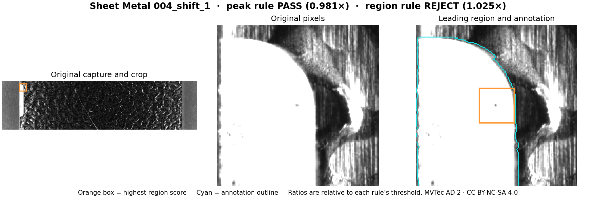
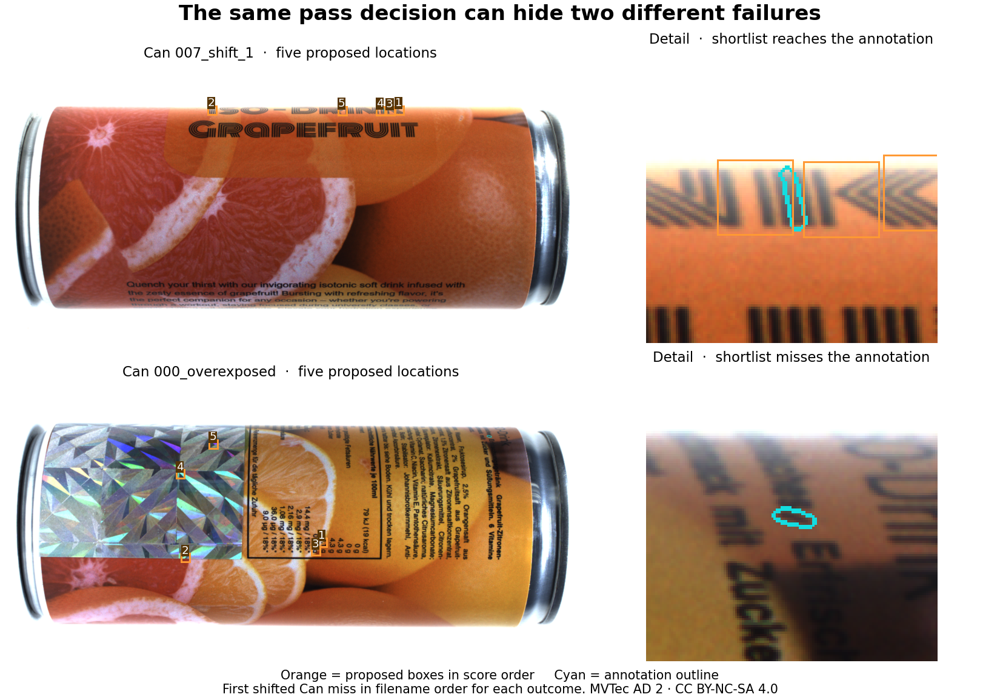
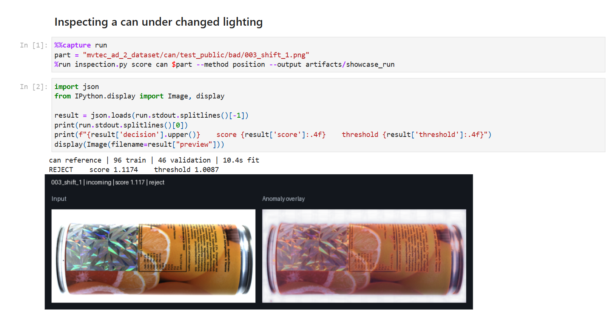

# Tiny Defects Under Changing Light

I wanted to know what happens to a defect detector when the same part comes back under a different light. On a printed drink can, a reflection can look more unusual than a scratch. And if I shrink the photo to fit a model, a scratch that was visible in the original can all but disappear.

I built a PyTorch inspector that learns from images of good parts. Then I followed its mistakes through **1,084 public MVTec AD 2 images of 184 scenes**. The biggest improvement in catching defective parts came on **Sheet Metal**. Under changed lighting I went from **30 to 50 detections out of 75 defective captures**, with the same **3 false rejects out of 20 good captures**.



*The orange box is the region my model picked. Cyan outlines the dataset annotation. This is the first newly caught shifted Sheet Metal image in filename order where the leading box overlaps the flaw.*

[Detailed project report](PROJECT_REPORT.md) · [Follow-up experiments by category](results/hotspot_study.md) · [Research notes](RESEARCH.md)

## How I got there

**First I checked what resizing cost.** I compared two versions of the same frozen ResNet-18, using the same 96 good training images of cans. One saw the entire photo resized to fit a 256-pixel square. The other inspected overlapping 256-pixel tiles at original resolution and stitched the scores back together. Under changed lighting, Can localization went from **5.78% to 46.39% AU-PRO**. This metric measures how well the model covers individual defect regions while limiting the background it marks.

I also tried correcting the lighting, changing the feature extractor, and training on simulated defects. Mild Retinex correction edged Can localization up to 46.88%, yet it missed 12 more defective captures at the fitted threshold. That result sent me back to the actual mistakes.

**Then I followed the misses.** Even with the sharper map, the inspector passed 54 of 75 defective Can captures. I drew boxes around its five strongest responses. They touched the actual flaw in only **2 of those 54 misses**, both views of one can. On Sheet Metal they found the flaw in **26 of 45 misses**. That gave me two ideas to test. For Sheet Metal, I could change how I scored a region the model already saw. For Can, I could change which good patches the model compared it with.

**I tried both.** For the new part decision I learned what ordinary hotspots look like from 32 additional good training images per category. For the new Can heatmap I gave nearby reference patches a preference when matching texture. In the image below, the original thresholded mask covers **32 of the 131 labeled defect pixels**. Adding position brings it to **114**.


## The result in brief

| What I measured under changed lighting | Before | After |
| --- | --- | --- |
| Sheet Metal decisions, peak score → region score | 30/75 defective caught, 3/20 good rejected | **50/75 caught, 3/20 good rejected** |
| All eight categories, same change | 137/585 defective caught, 43/315 good rejected | **151/585 caught**, 47/315 good rejected |
| Can mask quality, native matching → position-aware | 46.39% AU-PRO, 2.89% pixel F1 | **47.74% AU-PRO, 8.02% pixel F1** |
| Fabric localization, same position-aware change | 45.00% AU-PRO | **37.20% AU-PRO** |

Pixel F1 measures how well the marked pixels match the annotation, accounting for both missed pixels and false marks. The Can masks improved, but using their peak to reject a part caught only **14 of 75** defective captures, down from **21**. I kept native fusion as my default and made region scoring and position-aware matching optional. Each capture is one lighting view, so several captures can show the same physical part.

I also ran the released CAT and SuperADD Can models on the **same public images**. CAT reached 33.87% AU-PRO and caught 48/75 defective captures at 32/60 false rejects. SuperADD reached 4.91% and caught 41/75 at 28/60. Their published decision rules differ. My direct comparisons use these public reruns. The report also covers official scores on MVTec’s separate private splits. [Matched model comparison](results/released_comparators.md) · [Dated benchmark context](PROJECT_REPORT.md#8-where-the-website-benchmark-fits)

<details>
<summary>See where the inspector looked when it missed</summary>



Both captures passed the original inspection. In the first, a box clips the defect. In the second, the inspector spends all five boxes elsewhere. I also tested exposure correction, alternate features, two sampling offsets, lighting-aware features, and requiring two detectors to agree on a location. [Original trials](results/experiments.md) · [Follow-up results](results/hotspot_study.md)

</details>

## Reproduce the study

I used Python 3.11 and an 8 GiB RTX 5060 Laptop GPU. Install matching PyTorch and torchvision builds, install the requirements, and extract the licensed AD 2 download into `mvtec_ad_2_dataset`. [MVTec AD 2 dataset](https://www.mvtec.com/research-teaching/datasets/mvtec-ad-2)

```sh
python -m pip install -r requirements.txt
python inspection.py score can mvtec_ad_2_dataset/can/test_public/bad/003_shift_1.png --method position --output artifacts/can_demo
python inspection.py regions sheet_metal mvtec_ad_2_dataset/sheet_metal/test_public/bad/004_shift_1.png --output artifacts/sheet_demo
```



*The Can inspection command running in a local notebook. The CLI saves the preview and a JSON decision. The annotation used for evaluation appears in the earlier comparison figure.*

The [full report](PROJECT_REPORT.md) includes the study design, all experiment stages, runtime, limitations, and reproduction commands. Images and annotations are from MVTec under CC BY-NC-SA 4.0. [Dataset attribution](https://www.mvtec.com/research-teaching/datasets/mvtec-ad-2)
