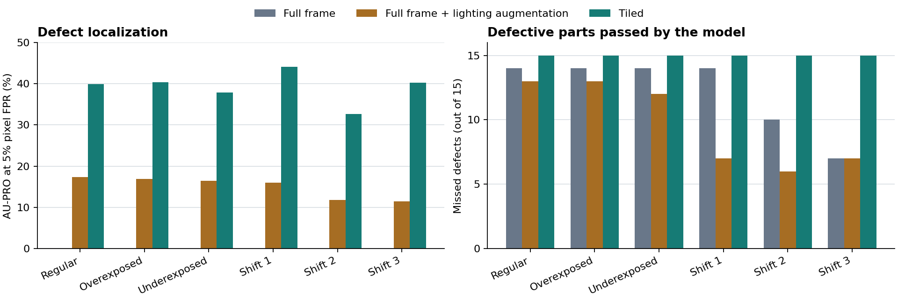

# Detecting Tiny Industrial Defects Under Changing Light

A faint scratch on a metal can can be visible in the original camera image and disappear when the image is resized for an inspection model. Change the lighting and a reflection can look like a scratch, or wash out the real one. On a production line, either problem can lead to good parts being rejected or defective parts making it through.

This project tests how much detail an inspection model gains by looking at overlapping crops of the original image, and whether that gain holds when the lighting changes. It also tests whether checking a few known-good parts under the new light helps recover reliable pass/fail decisions.

## First results

On the MVTec AD 2 `can` public split, tiling raised average defect localization from **0.0% to 39.2% AU-PRO** across six lights. The tiled model still passed every defective capture at the validation-derived threshold. Its image-level AUROC averaged 38.0% across the six lighting groups, so the next experiment needs a better way to turn patch scores into part decisions.



| Can model | Mean AU-PRO at 5% pixel FPR | Missed defects | False rejects | Median compute time |
| --- | ---: | ---: | ---: | ---: |
| Full frame | 0.0% | 73 / 90 | 13 / 72 | 30 ms |
| Full frame with lighting augmentation | 15.0% | 58 / 90 | 22 / 72 | 29 ms |
| Tiled | 39.2% | 90 / 90 | 15 / 72 | 168 ms |

These are local results from 15 defective and 12 good scenes, each photographed six times. Compute time is measured on an RTX 5060 Laptop GPU and includes preprocessing and stitching, with image decoding timed outside it. MVTec's official leaderboard uses the private splits. [MVTec AD 2 benchmark](https://benchmark.mvtec.com/)

The simpler `bottle` baseline caught all 63 defective test images and falsely rejected 3 of 20 good ones. In the `can` recalibration pilot, four reference parts reduced full-frame false rejects under `shift_3` from 3 to 0 out of 8 held-out good scenes. Missed defects in that condition rose from 7 to 11 out of 15. A threshold change alone offered little help on the tiled runs.

In the [part-scoring follow-up](results/scoring_comparison.md), removing broad responses from the part score caught 24 more defective `can` captures and 12 more `sheet_metal` captures at the calibrated thresholds, with the same pooled false-reject counts. The original tiled heatmaps still gave the strongest localization.

The [transfer test on fabric and wall plugs](results/hybrid_transfer.md) kept those raw heatmaps and used local contrast only for part decisions. It produced fewer false rejects and more missed defects in both new categories at the tested thresholds.

In the [reduced SuperADD comparison](results/superadd.md), processing the native-scale image raised AU-PRO from 6.4% to 11.1%, while tiny-region overlap fell from 17.2% to 9.1%. Tiled PatchCore still led on overall localization for these local runs.

## The experiment

1. **Get the pipeline working.** Run PatchCore on the `bottle` category from the original MVTec AD and check its heatmaps against the defect masks.
2. **Measure what resizing and lighting do.** Compare full-frame and tiled PatchCore on the same MVTec AD 2 `can` scenes photographed under six lighting conditions. Measure how often each method misses defects, rejects good parts, and correctly locates the defect. Record processing time per image.
3. **Test a stronger detector.** Use SuperADD as a reference and test whether a finer-resolution pass improves localization. Repeat the comparison on `sheet_metal` and run a separate `can` pilot that adjusts the pass/fail threshold from a few known-good parts. [SuperADD report](https://arxiv.org/abs/2605.14808)

## The detail branch

The `can` detector ranks the defect only at about the 94th percentile of its own background. Two measurements motivate a second, native-resolution branch: 14 of 16 `can` defect regions are *darker* than their surroundings in all six lighting conditions, and a 25-pixel defect spans only about three stride-8 feature cells. Both problems limit what a ResNet-18 feature grid can express. `detail_branch.py` adds a one-sided "unexpected local contrast" residual at native resolution and fuses it with the deep map (see [the report](results/detail_branch.md)).

On the public `can` split this branch gives +9.5 AU-PRO@5% against the control at seed 42, +11.2 at seed 7 and +7.6 at seed 1234, with the worst lighting condition improving by about 12 points in each case. On `sheet_metal` the same polarity choice hurts and its opposite polarity helps; on `fabric` no polarity helps. The polarity is a per-category inspection decision, not a tuning freebie — it is chosen on the public development split and disclosed.

A learned pixel-wise combiner trained on synthetic defects (`fusion.py`) underperforms the hand-tuned branch; a static-backdrop suppression accelerates the ranking of defect pixels without changing AU-PRO; and the authors' released SuperADD bank underperforms the tiled baseline on this split. These negative results are part of the study, not gaps in it.

```sh
python run_detail.py can --synthetic 64
python run_detail.py sheet_metal fabric --synthetic 48
python build_report.py
```

`prepare_submission.py` builds a leaderboard submission directory (continuous float16 TIFF maps plus binary masks calibrated on good validation pixels — the 99.5th percentile by default, the benchmark FAQ's mean + 3σ via `--threshold-rule mean3sigma`) for all eight categories. It does not upload anything; uploading is a manual step through the benchmark website.

## Run the baseline

Use Python 3.11. Install matching PyTorch and torchvision builds for your device, then install the project dependencies. The experiments below used the CUDA 12.8 builds of PyTorch 2.11 and torchvision 0.26. [PyTorch installation instructions](https://pytorch.org/get-started/previous-versions/#v2110)

```sh
python -m pip install -r requirements.txt
```

Extract the original MVTec AD to `MVTECH_ANAMOLY_DATASET` and MVTec AD 2 to `mvtec_ad_2_dataset`. You can pass `--dataset` to use a different folder.

```sh
python build_scene_manifest.py
python run_experiment.py bottle
python run_experiment.py can
python run_experiment.py can --mode tiled
python run_experiment.py can --augment-lighting
python calibrate_lighting.py artifacts/can/full
python calibrate_lighting.py artifacts/can/tiled
python compare_scoring.py can
python compare_scoring.py sheet_metal
python run_detail.py can
python prepare_submission.py --categories can
```

The manifest checks image-to-mask filenames and groups 162 `can` captures into 27 scenes. Each experiment writes per-image scores, per-lighting metrics, and sample visualizations under `artifacts/<category>/<mode>/`. CUDA is used when available. `--device cpu` forces a CPU run.

The baseline uses a frozen ResNet-18 and a uniformly sampled memory bank of 4,096 patch features from good training images. Each variant sets its own pass/fail threshold at the 90th percentile of good regular-light validation scores, then keeps that threshold fixed for every test light. Tiled inference uses 256-pixel crops with at least 25% overlap. This is a PatchCore-style baseline with a simpler bank and score rule than the paper. Local AU-PRO uses 4,096 score bins at a 5% pixel false-positive limit. See the [project plan](PROJECT_PLAN.md) for the official benchmark protocol. [PatchCore paper](https://arxiv.org/abs/2106.08265)

## Datasets

Download the datasets from MVTec. Both are released under CC BY-NC-SA 4.0. [Original MVTec AD](https://www.mvtec.com/research-teaching/datasets/mvtec-ad) · [MVTec AD 2](https://www.mvtec.com/research-teaching/datasets/mvtec-ad-2)
