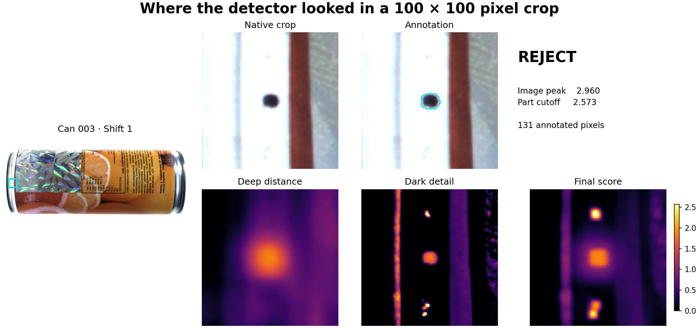

# Tiny Defects Under Changing Light

I got into industrial computer vision after looking through my previous employer’s portfolio. Reading about inspection systems, I kept coming back to a problem with shiny parts. Change the light and a reflection moves. Resize the image and a scratch that was visible on the original can almost disappear. MVTec AD 2 had something I could use to study both problems. It includes photographs of the same can under six different lights.

I built a PyTorch inspector that draws a heatmap over the places worth a closer look. **My best result was 67.53% localization AU-PRO on the public Can split** when the inspector could use all six aligned photographs. Given just one photograph at a time, it reached **66.71%** across those same lights.


*Follow the mark beside the printing from left to right. Each column shows the same patch of metal under a different light. At the far right, the cyan outline marks the 131-pixel defect and the heatmap below it is my six-view prediction.*

## How the final inspector works

1. **Learn the surface of a good can.** I split 412 good training photos into overlapping 256 × 256 tiles at their original resolution. A frozen ResNet-18 converts each tile into patch features. Each patch gets a score based on its distance from the closest example in a bank of 4,096 normal features.
2. **Look for the mark inside the patch.** A second score measures how dark each pixel is relative to its 25 × 25 neighborhood, accounting for how much the surrounding brightness varies. I calibrated both signals on 46 separate good images, added the dark-detail map at a weight of 0.75, then applied a 5 × 5 maximum filter and scaled the result.
3. **Combine the evidence.** I average the finished heatmaps from three independently sampled banks of good patches. That gives a prediction for one photograph. When all six aligned views are available, I average their maps pixel by pixel. A scratch can contribute at the same location across several lights, even when a reflection is prominent in only one.



*This single-bank example shows what each signal contributes. The dark-detail map picks up the mark inside the cyan outline. It also responds to nearby printing, which is why I checked false alarms separately.*

## How I got there

My first clue came from measuring what resizing cost. In the regular-light Can images, the median defect occupied 129 original pixels. Fitting the long edge to 256 pixels reduced that to **1.59 pixels** of area. I switched to native tiles, then looked at the annotated misses. Fourteen of sixteen Can defect regions were darker than their surroundings under every light. That observation led me to add the pixel-level dark-detail score. [Resizing audit](results/lighting_audit.json) · [Detail experiments](results/contrast_experiments.md)

| What I tried on public Can | AU-PRO across all six lights | AU-PRO on the five changed lights |
| --- | ---: | ---: |
| Match normal patches at native resolution | 46.72% | 46.39% |
| Also account for where each patch sits on the can | 48.17% | 47.74% |
| Add local dark contrast, one reference bank | 63.94% | 63.85% |
| Average three reference banks, one photo at a time | 66.71% | 66.62% |
| Average the six aligned views of each can | **67.53%** | **67.53%** |

The largest gain came from looking back at the pixels. The comparison also spans a change from 96 good training photos in the first two runs to 412 in the later ones. Simulated lighting during training brought the three-bank score down to 65.28%. Combining real views added 0.82 percentage points over the single-view ensemble. The last row has identical values because each view of a scene gets the same prediction and its six annotations agree. [Experiment records](results/experiments.md) · [Final measurements](results/can_ensemble_multiview.json)

## What the score tells me

AU-PRO measures how well a heatmap covers individual defect regions as the allowed rate of falsely marked background pixels increases from 0% to 5%. I evaluated **27 Can scenes** (15 defective, 12 good) photographed six times each. I used these public scenes to choose the contrast settings and bank seeds, so the figures are development results. On the same five changed lights with one image per prediction, I measured **66.62%** for my ensemble, **33.87%** for the released CAT model and **4.91%** for SuperADD. MVTec ranks methods on separate private images. [Released-model comparison](results/released_comparators.md) · [MVTec leaderboard](https://benchmark.mvtec.com/)

**Would I use the heatmap to reject a can automatically?** At the cutoff calibrated on good single images, the ensemble caught only **6 of 75** defective changed-light captures and rejected **8 of 60** good ones. I’d use it to point a reviewer toward small marks. For Sheet Metal, a separate experiment showed that changing how I scored a suspicious region raised detections from **30 to 50 of 75** with the same three false rejects. That distinction between locating a flaw and deciding whether to reject a part shaped how I evaluated the project. [Part-decision experiments](results/hotspot_study.md)

## Reproduce the study

I used Python 3.11 and an RTX 5060 Laptop GPU. Place the Can category at `data/mvtec_ad_2/can/` and run these commands from the repository root. The evaluation writes the per-light scores and example maps to `artifacts/can_multiview/`. Dataset images and annotations are from MVTec AD 2 (CC BY-NC-SA 4.0). [Dataset and terms](https://www.mvtec.com/research-teaching/datasets/mvtec-ad-2)

```sh
python -m pip install -r requirements.txt
python -m local_contrast.multiview --skip-inp
python -m local_contrast.showcase --scene-maps artifacts/can_multiview/can_003.npz --out artifacts/can_multiview/can_ensemble_views.png
```

[Detector and evaluation code](local_contrast/) · [Earlier experiments](experiments/) · [Research notes](docs/research.md) · [Visual gallery](results/visuals/)
