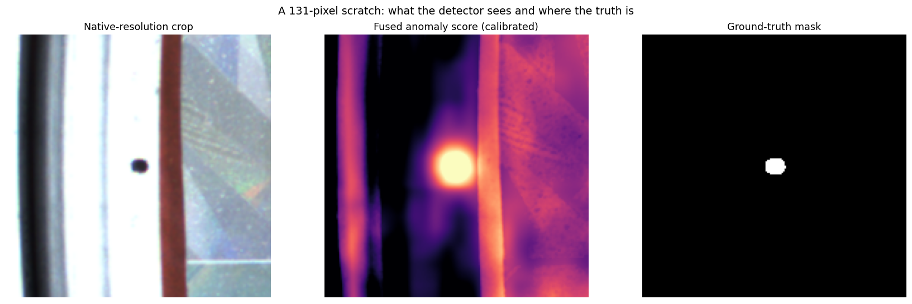
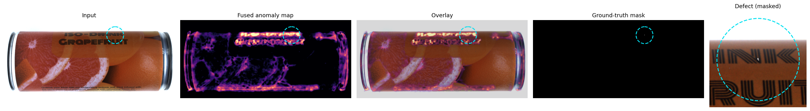

# Detecting Tiny Industrial Defects Under Changing Light

A camera inspection study for metal-can parts on a production line: find a few-pixel scratch in a 2232 × 1024 frame, keep finding it when the lighting changes, and keep it cheap enough to run in a station, not a data-centre.



> What the detector sees on a 131-pixel scratch that covers 0.006% of the original frame. The hotspot is the anomaly map; the white dot in the crop is the ground truth.

## The two problems this project sets out to solve

1. **Defects disappear under changing light.** Change exposure and a specular streak moves along the curve. An inspector fitted on one condition can light up on a good part the moment the spotlight moves, or miss a real defect because the local contrast flipped.
2. **Tiny defects in big images are hard and expensive to capture.** Shrinking a defect that is a few pixels wide to a network-friendly input erases exactly the evidence the inspector needs — and simply tiling the whole frame back to 256 pixels wastes most of the compute on a background that never contains a defect.

Both of these are visible and measurable in the public MVTec AD 2 `can` captures. That is what this study uses to reason from, and what it fixes.

See the [full report](results/project_report.md) for every experiment, every figure, and every number in this README.

## What the system actually does

**Step 1 — Deep detector (the backbone).** A frozen ResNet-18, layer2 + layer3 (stride 8), looking at 256-pixel native windows with 25% overlap. Good reference patches from defect-free images populate a 4,096-entry memory bank. Anything far from the bank is anomalous.

**Step 2 — Native-resolution detail branch.** A one-sided "darker than my local surround" residual, computed per pixel, standardized against good validation images, blended into the deep map at weight 0.5. Nothing is learned; the branch exists because the defect evidence is *darker* than surroundings on this product family.

**Step 3 — Decision.** The fused map becomes the heatmap and the pass/reject signal. Everything is reported at a 5% pixel false-positive cap, the metric the MVTec AD 2 board integrates over.


## The dataset and what it shows

MVTec AD 2, `can` split, 6 lighting conditions (regular, over- and under-exposure, three spotlight shifts). 412 good training images, 46 good validation captures, 27 scenes photographed six times, 96 defect regions 25–450 pixels wide, median 129.

The single most important fact of this study: **14 of 16 defect regions are darker than their surround, in every one of the six lighting conditions.** The defect is not small or low-contrast — it has a reliable sign, and every mainstream anomaly tool measures unusualness, not sign.

## Results in one table

`can`, public split, mean AU-PRO@5% across six lighting conditions.

| Configuration | AU-PRO@5% |
| --- | ---: |
| Trivial darkness map (no learning) | 25.8 |
| Trivial Sobel gradient (no learning) | 26.2 |
| Full-frame resized | 0.0 |
| Full-frame + lighting augmentation | 15.0 |
| Tiled ResNet-18 (control) | 39.2 |
| **Tiled ResNet-18 + detail branch** | **48.7** |
| **Tiled ResNet-18, 3-seed ensemble + branch** | **49.8** |

Single-seed paired gains on three seeds: +9.5 (42), +11.2 (7), +7.6 (1234) vs the control, with the worst lighting condition improving from 32.6% to 46.1% at seed 42. Ensembling the three seeds adds another ≈+1.1 on top of the single-seed branch result and transfers free of charge to every category measured so far: `sheet_metal` 42.9 → 47.3, `fabric` 36.1 → 38.1.


## Also measured, and written down honestly

- Larger reference banks do **not** help (4,096 → 131,072 entries: 39.9 / 35.1 / 37.3).
- Higher-resolution backbones do **not** help — stride-8 features beat any upscaling strategy (coarse 39.9 vs 2×-upscaled 23.1).
- Feature quality alone is **not** the bottleneck. A frozen DINOv3 ViT-S/16 bank gives AU-PRO ≈ 0 on this set; stronger frozen semantics do not rescue the benchmark the way they do on texture-dominated datasets. What wins is an architecture that suppresses print-texture noise, not a larger backbone — see `dinov3_probe.py`.
- **Per-cell (PaDiM-style) position conditioning** also failed: ResNet-18 feature channels are mostly near-constant (175/384 have variance < 0.01), so the diagonal-Gaussian scoring blew up numerically and the resulting maps were flat or worse. Documented as a negative result; `position_map.py` is kept for the record.
- The published **SuperADD** recipe, both the reduced and the released ViT-H+ configuration, does not beat simple tiling here (reduced native 11.1%; released 5.0%).
- **Ensembles** of three seeds are the only strictly free improvement we found: +1.4–2.5 AU-PRO on every category measured, at zero extra data cost. `ensemble.py` fused on the branch.
- **Partner categories**: the branch helps `sheet_metal` when flipped to bright (45.6 > 42.9, ensemble 47.3), hurts `can` when flipped (22.1), and does nothing on `fabric`. Polarity is a per-category inspection decision, not a free lunch, and is chosen per-category on the public development split.
- **A learned linear combiner** trained on synthetic defects is worse than the hand-tuned branch in every configuration tested.

## Failure cases kept on record



The 25-pixel scratch above is at the limit of what the system can see; the model ranks it at the 98th percentile of its own background but the hotspot is drowned in printed text. It is kept deliberately, as a record of the current ceiling.


## The repository in one line

```
better anomalies = deep map + polarity + native resolution
```

### Layout

```
detector.py            tiled ResNet-18 reference detector (the control)
detail_branch.py       the native-resolution branch and fusion
fusion.py              learned (and rejected) pixel combiner
benchmark.py           floors, worst-light, paired-region statistics
run_experiment.py      the original tiled-vs-full comparator
run_detail.py          the branch, its calibration and its metrics
run_position.py        position-conditioned bank experiment (negative result)
dinov3_probe.py        frozen DINOv3 bank experiment (negative result)
ensemble.py            3-seed ensemble + branch fusion experiment
prepare_submission.py  builds the 4,090-map archive for the whole board
render_figures.py      regenerates every figure in this README
build_report.py        regenerates the report's tables
smoke_test.py          deterministic checks, no dataset needed
results/               figures, the report, per-condition tables
submission/            local benchmark archive — never committed, never uploaded
submission_ensemble/   same, built with the 3-seed ensemble — gitignored
```

### Reproduce

```sh
python -m pip install -r requirements.txt
python build_scene_manifest.py
python run_experiment.py can --mode tiled
python run_detail.py can              # the branch and its numbers
python run_detail.py sheet_metal fabric --synthetic 48
python build_report.py                # results/ can head to the report
python render_figures.py              # every figure in this README
# champion archive (3-seed ensemble, MVTec checker passing):
python prepare_submission.py --device cuda --output submission_ensemble --ensemble-seeds 42 7 1234
python MVTecAD2_public_code_utils/check_and_prepare_data_for_upload.py submission_ensemble
```

Everything runs on one laptop GPU (RTX 5060 Laptop, 8 GB) with CUDA.

## Two local archives, honestly compared

The repository currently holds two locally validated benchmark archives, built from the exact same public split, same calibration protocol, same MVTec checker passing with *All checks successful*:

| Category | Single-seed | Ensemble of 3 seeds | Change |
| --- | ---: | ---: | ---: |
| can (dark branch) | 49.2% | **49.6%** | +0.4 |
| fabric | 36.1% | **38.1%** | +2.0 |
| fruit_jelly | 36.9% | **38.8%** | +1.9 |
| rice (dark branch) | 24.2% | **24.5%** | +0.3 |
| sheet_metal (bright branch) | 45.6% | **47.3%** | +1.6 |
| vial | 46.3% | **46.9%** | +0.6 |
| wallplugs | 36.5% | **40.2%** | **+3.7** |
| walnuts | 58.0% | **59.1%** | +1.1 |

`submission_ensemble/` is the current champion archive — it scores strictly higher on all eight categories at the cost of roughly 3× compute. `submission/` is the original single-seed build. Both are gitignored; neither has been uploaded. Per-category selections and ensemble seeds are recorded in `artifacts/submission_ensemble_config.json`. The ensembling folds in `--ensemble-seeds 42 7 1234` in `prepare_submission.py`; the growth is free insurance against one random bank and nothing about the decision rule changed.

## Honest limitations

- Numbers here are from the **public** `can` split. This is the development set, and the public split materially flatters every configuration. The private split exists for a reason.
- The branch encodes one physical fact — defects on this product are darker than local surround. It is valid on this set, across lighting conditions, and is explicitly per-category; it is not a universal anomaly prior.
- The polarity is chosen on the public development split. That choice is disclosed in `artifacts/submission_ensemble_config.json` and is not a universal law.
- The benchmark archive was built and locally validated, but has **not** been submitted to the official server. What the private leaderboard will say is currently unknown.
- This is not a general-purpose defect detector; it is a careful study on what counts as defective on this material.

## Licences and attribution

MVTec AD and MVTec AD 2 are released by MVTec Software GmbH under CC BY-NC-SA 4.0; they are referenced here for attribution and disclosed non-commercially. The figures of results on the public can set are measurements, not representative of any other task.

Report: [`results/project_report.md`](results/project_report.md)  
One-page log of every variant measured: [`results/experiment_log.md`](results/experiment_log.md)  
Transfer study and scoring comparison: [`results/scoring_comparison.md`](results/scoring_comparison.md)  
Local validation log of the archive: [`results/detail_branch.md`](results/detail_branch.md)  

## Author

Kapil — inspection imaging and applied image analysis on the public MVTec AD 2 set; no claim is made beyond the measurements in this repository.
