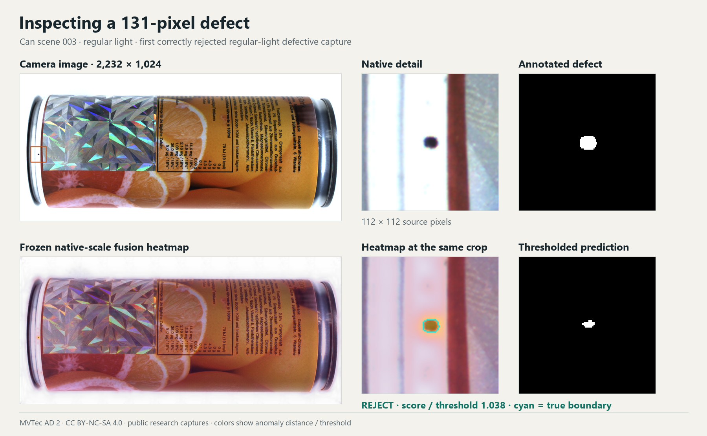
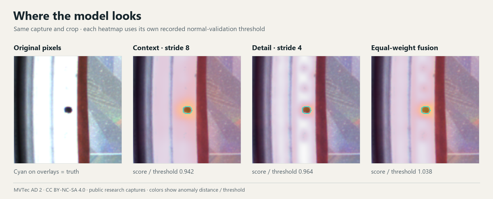
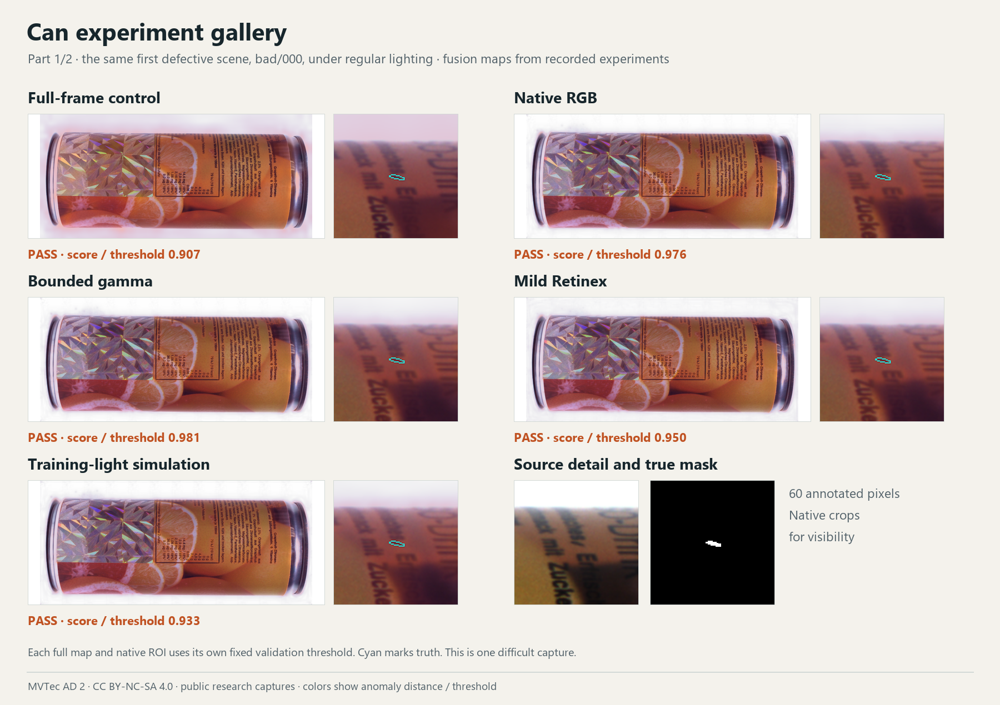

# Tiny Defects Under Changing Light

**Industrial anomaly detection · Computer vision · PyTorch · MVTec AD 2**

I started this project after reading about defect detectors becoming unreliable when lighting changes or reflections appear. Tiny scratches added another problem. Resizing a large image could remove the very detail the model needed to inspect.

I wanted to see how much of that I could solve using MVTec's existing images. I built a normal-image inspector, tested ten configurations on Can, checked transfer across all eight AD 2 categories, and ran the released CAT and SuperADD models on the same public Can captures.



*Actual MVTec Can scene `bad/003`. Warm colors indicate larger anomaly scores. Cyan marks the dataset annotation, and the white thresholded region is the model prediction. I chose the first regular-light defective scene correctly rejected by fusion for this illustration.*

[Read my detailed project report](PROJECT_REPORT.md) · [Full experiment results](results/experiments.md) · [Research review](RESEARCH.md)

## The result in brief

- **Preserving image detail made the biggest difference.** My native-resolution fine/context model reached **46.39% AU-PRO** on Can under changed lighting. The matched full-frame version reached **5.8%**.
- **Tiny-region coverage improved across categories.** Fine/context fusion raised mean tiny-region overlap from **63.7% to 73.2%** at 5% pixel false positives.
- **Pass/fail decisions remained difficult.** Across the eight categories, fusion missed 448 of 585 shifted defective captures versus 388 for context alone. It falsely rejected 43 of 315 good captures versus 63.

AU-PRO measures how well a heatmap covers defect regions while limiting marked background. Tiny overlap measures coverage of regions occupying at most 0.01% of the original image. The decision counts use fixed thresholds estimated from good regular-light validation images.

## What the inspector does

I use a frozen ResNet-18 to compare image patches with good examples from the same product category.

1. Scan the original image with overlapping 256-pixel tiles.
2. Score **fine features at stride four** and **context features at stride eight** against their normal references.
3. Stitch both maps back into the original image coordinates.
4. Scale the maps using good validation images and average them.
5. Save an anomaly overlay, image score, and pass/reject decision.

The reference banks contain 1,024 fine and 4,096 context features. Chunked nearest-neighbor matching keeps the denser search manageable on an 8 GiB laptop GPU.


<details>
<summary>Inspect the feature branches and the same part under six lights</summary>




The cyan boundary comes from each capture's annotation. Every displayed score uses the recorded normal-validation threshold.

</details>

The images above are outputs from the implemented detector. The report includes the source scenes, ground-truth masks, display scales, and examples where localization and the final decision disagree.

## What I tried

| Question | Experiments | What I found |
| --- | --- | --- |
| Does shrinking the image hide defects? | Full-frame input versus native overlapping tiles | Native fusion improved changed-light Can AU-PRO by about 40.6 percentage points. |
| Does finer detail help? | Context alone, fine features alone, and fusion | Fusion improved Can localization and mean tiny-region coverage. Transfer depended on the category. |
| Can preprocessing handle lighting? | Bounded gamma, mild Retinex, and simulated lighting during training | Retinex reached 46.9% Can AU-PRO but missed 12 more defects than native RGB fusion at the fixed threshold. |
| Would a different reference or representation help? | Coresets, DINOv3 ConvNeXt-Tiny, gradients, synthetic-defect learning, and student–teacher learning | Coresets helped Fabric and Wall Plugs localization. The other tested fine branches trailed native ResNet features on Can. |
| Can a few good references repair the decisions? | Median offsets, affine score calibration, feature correction, and drift alerts | The tested adaptations traded errors or generated substantial referral burden. |

<details>
<summary>View actual predictions from all ten Can experiments</summary>




All ten cards use the same regular-light Can scene, `bad/000`. Each overlay and native-coordinate crop comes from its recorded model configuration. The captions retain the actual decision and score-to-threshold ratio.

</details>

The controlled Can screen used the same 96 good source images per configuration, plus simulated normal views where specified. The wider study evaluated **1,084 public captures of 184 scenes**. All lighting views of a scene stay together in paired uncertainty estimates. [Every configuration and its results](PROJECT_REPORT.md#6-the-experiments-in-order)


<details>
<summary>See the inspector on all eight AD 2 categories</summary>


I used the first defective regular-light capture from each category. Each PASS in this gallery is a missed defect. The chart and full tables summarize the complete evaluation.

</details>

## Comparison with released models

I ran CAT's released Can checkpoint and SuperADD's full released Can reference bank on the same public images. This table covers the five changed lights.

| Method | Localization AU-PRO | Tiny overlap | Pixel F1 | Missed defects | False rejects | Median compute |
| --- | ---: | ---: | ---: | ---: | ---: | ---: |
| **My native RGB fusion** | **46.39%** | **73.14%** | 2.89% | 54 / 75 | **15 / 60** | **215 ms** |
| Released CAT | 33.87% | 42.00% | **4.21%** | **27 / 75** | 32 / 60 | 2,027 ms |
| Released SuperADD | 4.91% | 9.04% | 0.00% | 34 / 75 | 28 / 60 | 3,141 ms |

My model gave the strongest localization in this local comparison. CAT caught more defective parts and rejected more good parts at its published binary-mask threshold. Each model's decision rule and source calibration are documented with the measurements. [Reproduction details and metrics](results/released_comparators.md)

For context, the official board's highest posted mixed-private Can AU-PRO was **80.97%** on November 17, 2026. Those scores use private captures. I use the matched public reruns above for direct model comparisons and keep the dated leaderboard figures in the report. [Benchmark context](PROJECT_REPORT.md#8-where-the-website-benchmark-fits) · [Official board](https://benchmark.mvtec.com/)

## Where it still fails

Reflections and normal texture can produce stronger scores than a small defect. A useful-looking heatmap can also sit below the image rejection threshold. On shifted Wall Plugs, the fused model passed all 75 defective captures at that fixed threshold. I kept these failures in the results because the error trade-off is part of the outcome.


## Reproduce the study

Use Python 3.11 and matching PyTorch/torchvision builds. My GPU runs used an RTX 5060 Laptop with CUDA 12.8.

Download MVTec AD 2 and extract it into `mvtec_ad_2_dataset`. The original MVTec AD Bottle check uses `MVTECH_ANAMOLY_DATASET`. Both datasets use CC BY-NC-SA 4.0. [MVTec AD 2](https://www.mvtec.com/research-teaching/datasets/mvtec-ad-2) · [Original MVTec AD](https://www.mvtec.com/research-teaching/datasets/mvtec-ad)

```sh
python -m pip install -r requirements.txt

# Run Can and save real prediction previews.
python multiscale_experiment.py can --previews

# Score an image and save its overlay and decision.
python inspection.py score can mvtec_ad_2_dataset/can/test_public/good/000_regular.png --method fusion --output artifacts/inspection

# Repeat the eight-category comparison.
python multiscale_experiment.py can fabric fruit_jelly rice sheet_metal vial wallplugs walnuts --previews

python report_experiments.py
```

Runs save metrics, per-image scores, selected training paths, thresholds, and previews under `artifacts`. Pass `--dataset` for a different data location and `--device cpu` for CPU execution. The default source budget is 96 normal images per category. `--train-limit 0` uses the complete normal training split.

The repository also contains a local map exporter validated on all 4,090 private images. The measured project results use the labeled public split. [Local archive manifest](results/benchmark_export.json)

## Explore the work

| Read | Contents |
| --- | --- |
| [Detailed project report](PROJECT_REPORT.md) | The original question, research, implementation, every experiment stage, final choices, and limitations. |
| [Experiment tables](results/experiments.md) | Per-configuration and per-category results with metric definitions. |
| [Released CAT and SuperADD comparison](results/released_comparators.md) | Matched public Can results, pinned code, checkpoint hashes, and commands. |
| [Lighting and adaptation study](results/acquisition_and_adaptation.md) | Resizing audit, lighting alerts, and verified-good reference replays. |
| [Research notes](RESEARCH.md) | The literature and calculations behind the tested ideas. |

The figures use MVTec images and masks with model outputs from this project. Their source paths, scene IDs, and rendering choices are recorded in the [visual manifest](results/visuals/manifest.json). MVTec imagery and masks remain subject to CC BY-NC-SA 4.0. [Dataset attribution](https://www.mvtec.com/research-teaching/datasets/mvtec-ad-2)
