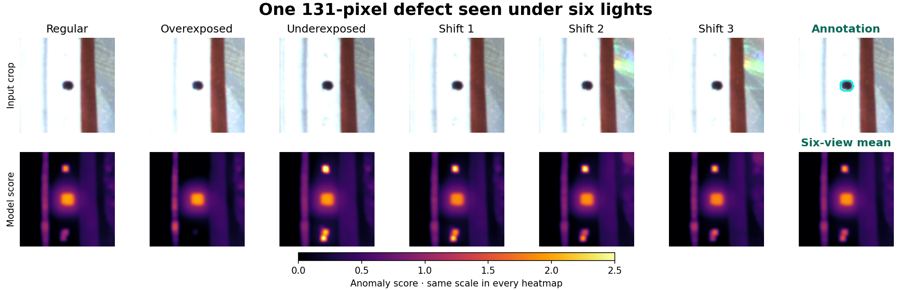
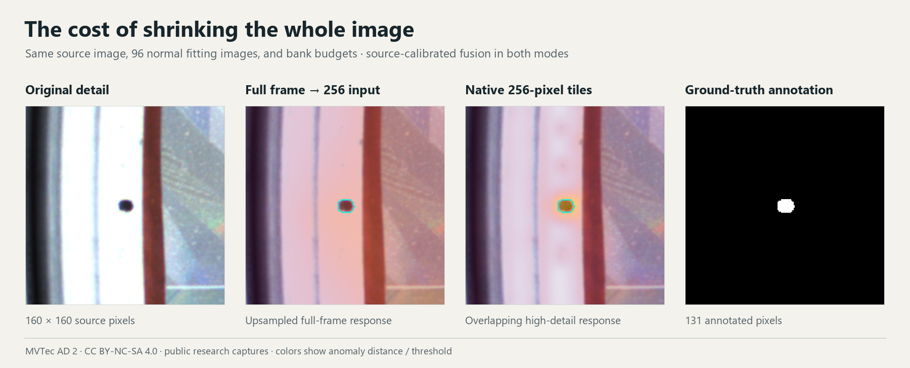
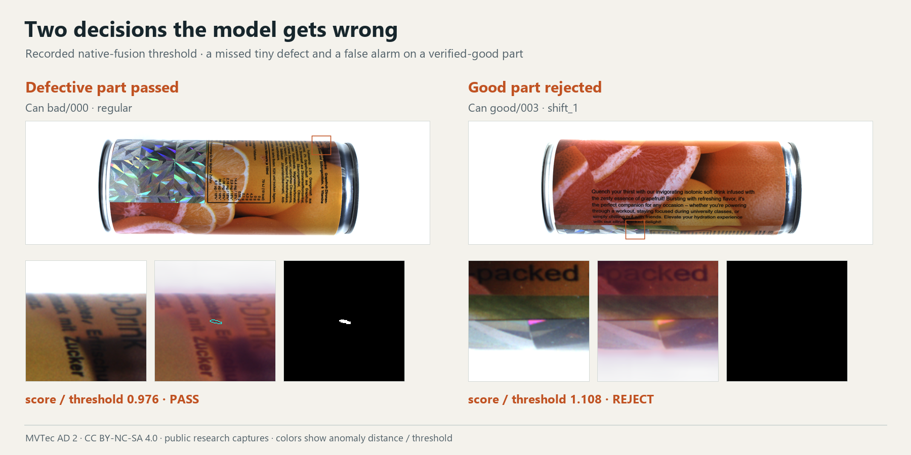

# Tiny Defects Under Changing Light

I got into industrial computer vision after looking through my previous employer’s portfolio. As I read more about how factories inspect parts, two problems caught my attention. A scratch can be visible in a full-size photo and almost disappear when the image is resized for a detector. On shiny metal, an ordinary reflection can attract more attention than the scratch. MVTec AD 2 gave me a way to investigate both problems. I could follow the same mark on the same can through six real lighting conditions and see exactly where my detector looked.

**My best result was 67.53% localization AU-PRO on public MVTec AD 2 Can**, using six aligned photos of each part. With only one photo available at a time, my detector reached **66.71%** across the same lights. I built it in PyTorch using good parts as its reference. The output I’d show an inspector is the heatmap below.



*Each column shows the same 100 × 100 pixels under a different light. Follow the small mark beside the printing. At the far right, the cyan outline encloses the 131 annotated pixels. The heatmap below it is the prediction after averaging all six views.*

## How the final inspector finds a flaw

1. **Keep the detail in the original photo.** A Can image is 2,232 × 1,024 pixels. I inspect overlapping 256 × 256 tiles at their original resolution and stitch the scores back into the photo’s coordinates. A frozen ResNet-18 extracts patch features. I compare each patch with its nearest match in a bank of 4,096 features sampled from 412 good training photos. The distance gives me a map of unfamiliar surface texture. I run the nearest-neighbor search in chunks so it fits on my laptop GPU.
2. **Give a thin scratch its own signal.** For each pixel, I measure how much darker it is than its 25 × 25 neighborhood, relative to the variation in that neighborhood. A faint dip on smooth metal can then register more strongly than the same dip in busy lettering. I use 46 separate good images to put the texture and darkness scores on comparable scales, then add the darkness score at a weight of 0.75. A 5 × 5 maximum filter lets a narrow response cover more of the mark. I scale the finished map per image.
3. **Combine independent observations.** Which good patches land in the bank depends on the random seed. I fit three banks (seeds 42, 7, and 99) and average their finished maps for each photo. When I have all six aligned photos of a can, I take one more average, pixel by pixel. A mark that stays in place contributes across views. A glint visible under just one light gets less weight. The scene grouping comes from the dataset. The defect outlines are used to evaluate the maps afterward.


*This single-bank run shows why I kept both signals. The texture response covers a broad area. The dark-detail response picks out the mark inside the outline and some ordinary printing nearby. The last panel is what the inspector makes from the two.* [Map construction](local_contrast/ensemble_maps.py) · [Multi-view evaluation](local_contrast/multiview.py)

## How I got there

My starting point was PatchCore’s idea of keeping a reference set of good patches. Good parts are plentiful in the dataset, and the nearest match gives me a score I can trace back to a location. I also looked at dense pretrained features, student–teacher models, and learning from artificial defects. I used the same public images to test what each idea bought me. [Research notes and papers](docs/research.md)

**I started by measuring what the model could actually see.** I checked the pipeline on Bottle from the original MVTec AD, then evaluated my baseline across all eight AD 2 categories (1,084 public captures of 184 scenes). Can stood out. The median marked area in its defective regular-light photos was 129 pixels. Resizing the long edge to 256 reduced that to **1.59 pixels of area**. In a controlled comparison using the same 96 good training photos, switching from resized frames to native tiles took changed-light Can localization from **5.8% to 46.4%**. That convinced me to keep the original pixels before trying a different backbone. [Resolution audit](results/lighting_audit.json) · [Controlled experiments](results/experiments.md)



*Both models saw the same good training photos. The crop is displayed at the same size on both sides, so you can see what detail survived each model’s input pipeline.*

**I opened the misses before changing the threshold.** The tiled baseline passed 54 of 75 defective Can captures under changed lighting. I drew boxes around its five strongest responses on each miss, then checked them against the annotations. The boxes touched the flaw in only **2 of 54**. A lower threshold might reject more cans, but it would still send someone looking in the wrong place. Making patch matching sensitive to position helped a little. The bigger clue came from the source images. **Fourteen of the 16 defect regions were darker than their surroundings under all six lights**. Darkness alone scored 25.8% across all lights and also picked up the printing. That led me to combine local darkness with the learned surface features. [Miss analysis](results/hotspot_study.md) · [Detail experiments](results/contrast_experiments.md)

**I tested the other plausible explanations.** On the same 96-image Can comparison, illumination correction with Retinex reached 46.9% under changed lighting, about half a point above native RGB, while missing 12 more defective captures at its own threshold. Compact synthetic-defect and student–teacher variants reached 25.2% and 33.3%. I also tested whether a few known-good examples under a new light could recalibrate the inspector. Across all 495 choices of four good Can scenes, the median-offset rule reduced average false rejects from 10.0 to 8.3 out of 40, while misses rose from 54.0 to 61.3 out of 75. I kept the local-detail approach because it improved the part of the system I could see failing. [Model trials](results/experiments.md) · [Lighting and adaptation study](results/acquisition_and_adaptation.md)

**Then I separated two ways of averaging.** First I changed which *normal patches* were available to match against. In the final configuration the three banks scored 64.09%, 64.99%, and 66.13% individually. Combining them beat all three while still requiring only one photograph. Then I changed how many *photographs of the part* the inspector could use. Averaging the six real views added another **0.82 percentage points** across all lights. Simulating lighting changes during training had taken the single-view ensemble in the opposite direction, down to 65.28%. [Seed experiments](experiments/refinements/seed_sweep.py) · [Training-data experiments](experiments/refinements/training_data.py)

| Can localization method | All six lights | Five changed lights |
| --- | ---: | ---: |
| Native tiles, texture features at two scales | 46.72% | 46.39% |
| Position-aware patch matching | 48.17% | 47.74% |
| Texture + local dark contrast, one bank | 63.94% | 63.85% |
| Three banks, one photo per prediction | 66.71% | 66.62% |
| Three banks, six aligned photos per prediction | **67.53%** | **67.53%** |

The first two runs used 96 good training photos and the later recipes used 412. The table tracks complete systems, so the jump to 63.94% includes that change in training budget. The final two rows isolate the contribution of the extra views. The last row has identical averages because the six captures of each Can scene share a prediction and have matching annotations. [Single-bank measurements](results/can_local_contrast.json) · [Ensemble measurements by light](results/can_ensemble_multiview.json)

## What the score tells me

I measured **where the heatmap landed** separately from **whether the part was rejected**. AU-PRO measures coverage of individual defect regions over a range of pixel thresholds, here up to 5% of background pixels falsely marked. At that 5% limit the six-view map covered **81.82%** of the tiny defect regions on average. I counted a region as tiny if it occupied at most 0.01% of the source image.

For a direct model comparison, I ran released CAT and SuperADD models on the same five changed lights, with **one photo per prediction**. There were 75 defective and 60 good captures, representing five views each of 15 defective and 12 good cans.

| Public Can, five changed lights | Localization AU-PRO | Defective captures caught / 75 | Good captures rejected / 60 |
| --- | ---: | ---: | ---: |
| My three-bank ensemble | **66.62%** | 6 | 8 |
| Released CAT checkpoint | 33.87% | **48** | 32 |
| Released SuperADD bank | 4.91% | 41 | 28 |

My heatmap covered defects best in this comparison. CAT caught the most defective captures at its released decision rule and rejected more good ones. My rule used the peak map score with a cutoff fitted on good single images. Applying that cutoff to the six-view mean caught **0 of 15 defective scenes**. The validation data contained only regular-light images, so I had no independent six-view set for calibrating that decision. I’d use the heatmap to guide a closer look. The available results give me little confidence in an automatic reject decision on Can. [Released-model protocols](results/released_comparators.md) · [Ensemble results](results/can_ensemble_multiview.json)



*Two mistakes from my earlier native-resolution baseline. On the left, the small annotated flaw slips through. On the right, a response on a good can crosses the threshold. Looking at examples like these is what led me to track localization, misses, and false rejects separately.*

**Where does that leave the leaderboard comparison?** I selected the contrast settings and seeds using the public scenes. My scores describe development on those 27 cans. In my November 17, 2026 snapshot of MVTec’s leaderboard, the highest posted Can scores were 94.68% on regular private images and 80.97% on mixed-light private images. My project has no private score or official rank. The reruns above are the comparison I can make on common images. [Saved leaderboard snapshot](results/benchmark_context.json) · [Official benchmark](https://benchmark.mvtec.com/)

## What carried over to other materials

The miss analysis gave me a different answer on Sheet Metal. There, the five strongest regions reached the defect in **26 of 45** baseline misses. The map already contained something useful for a decision. I compared each suspicious region’s location, peak, and contrast with similar regions from good parts. Under changed lighting that raised detections from **30 to 50 of 75**, with the same **3 false rejects out of 20**. Across all eight categories the rule caught 14 more defective captures at the cost of four more false rejects. [Region scoring and category results](results/hotspot_study.md)


*Both rules saw the same heatmap. The original peak rule passed this part. The region rule flagged a patch that overlaps the annotated flaw.*

I also tested whether the Can localization recipe transferred. Across each product’s available lights, single-view localization rose from **45.56% to 54.24% on Fabric**. On **Sheet Metal**, emphasizing bright marks took it from **44.84% to 52.60%**. Wall Plugs and Rice moved little, and **Vial fell from 38.80% to 34.35%**. Those runs changed how I’d start on a new material. I’d inspect the misses first and check whether the defect is visible in the map before choosing between a better map and a better decision rule. [Transfer experiments](experiments/refinements/category_transfer.py) · [Baseline measurements](results/multiscale.json)

## Reproduce the study

I ran the project with Python 3.11 and an RTX 5060 Laptop GPU with 8 GiB of memory. Place the MVTec AD 2 Can category at `data/mvtec_ad_2/can/`. Run these commands from the repository root to rebuild the three banks, evaluate both input settings, and render the six-view figure at the top of this page.

```sh
python -m pip install -r requirements.txt
python -m local_contrast.multiview --skip-inp
python -m local_contrast.showcase --scene-maps artifacts/can_multiview/can_003.npz --out artifacts/can_multiview/can_ensemble_views.png
```

To inspect one image with the earlier **single-bank** model, run the command below. It writes a native-size score array, a heatmap preview, and a JSON decision. On this example the peak was 2.960 against a cutoff of 2.573.

```sh
python -m local_contrast.inspect_can --image data/mvtec_ad_2/can/test_public/bad/003_shift_1.png --out artifacts/inspection
```

The photos and annotations are from MVTec AD 2 (CC BY-NC-SA 4.0). The heatmaps and inspection figures are outputs of this project. [Dataset and terms](https://www.mvtec.com/research-teaching/datasets/mvtec-ad-2) · [Research notes](docs/research.md) · [Experiments](experiments/) · [Results and visuals](results/)
