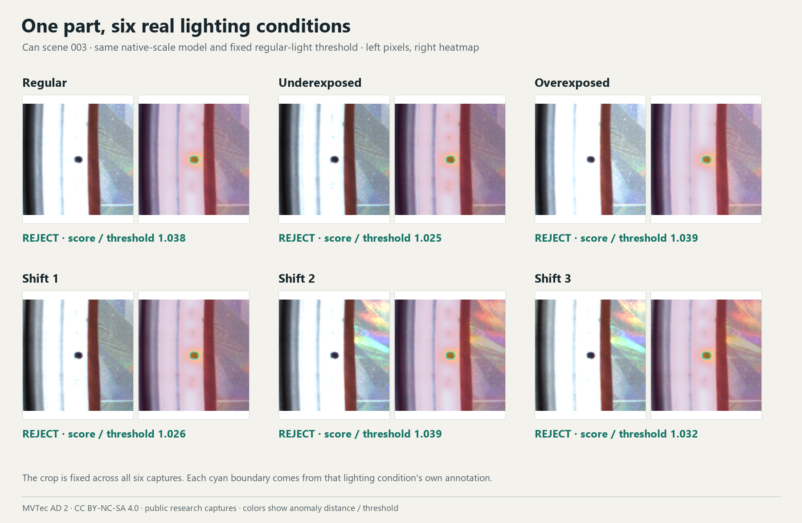
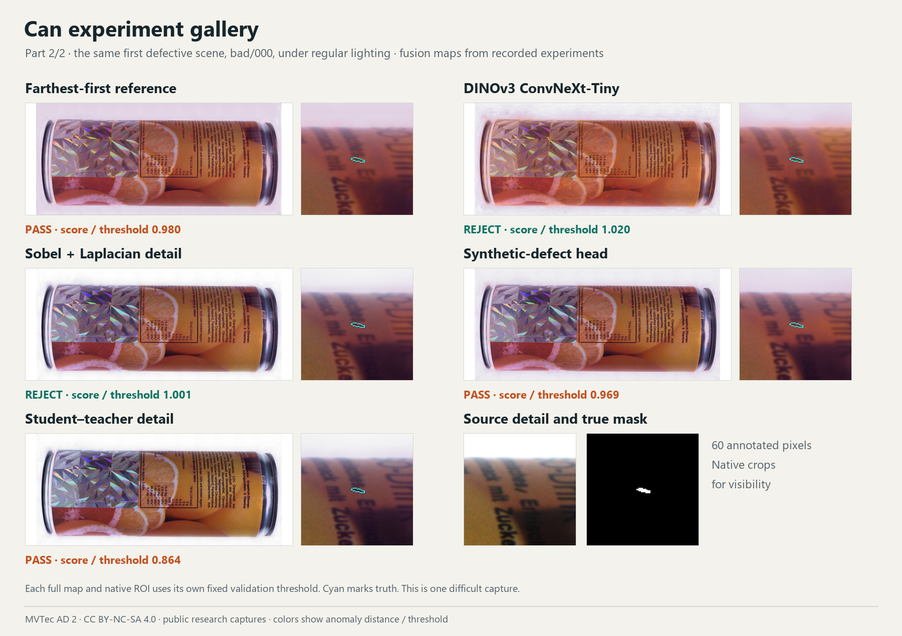
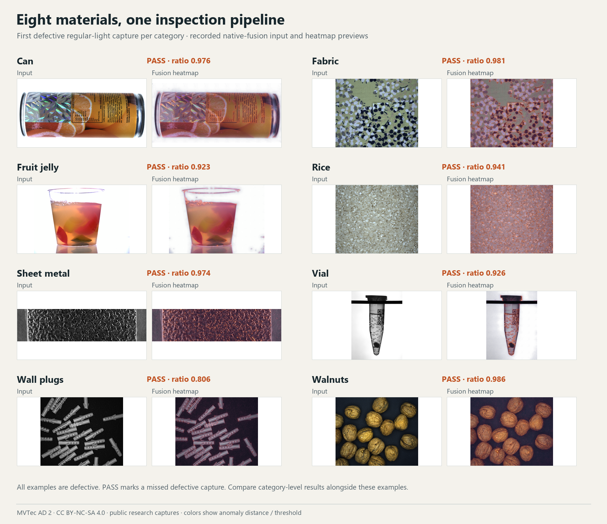
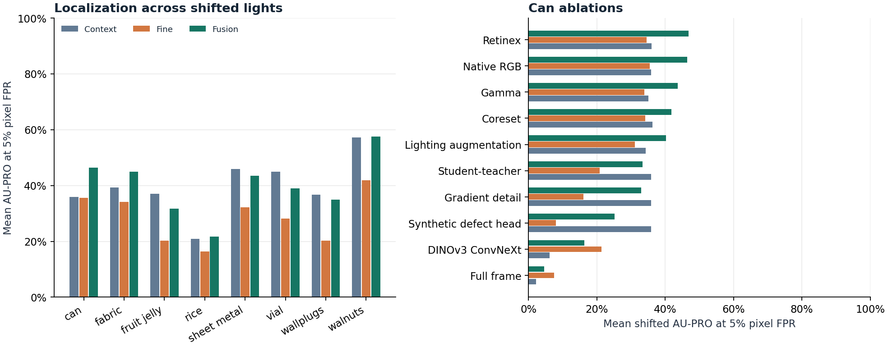
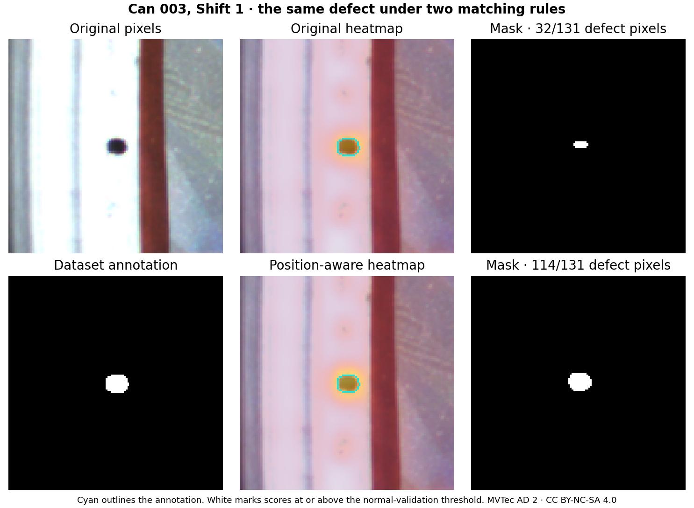

# Tiny Defects Under Changing Light

I got into industrial computer vision a while back after looking through my previous employer’s portfolio. It got me reading about how factories use cameras to inspect parts. Two problems kept coming up. A change of light can make a reflection on a good part look like damage. And a scratch can be perfectly visible in a high-resolution photo, then almost disappear when the image is resized for a model.

What made me want to try this myself was finding a dataset where I could follow the *same part* through several lighting conditions. I could look at a can, see exactly where the defect was, and check where my detector looked when the light changed. My starting question was whether an inspector trained on good parts could spot a change in conditions and still find small defects without collecting thousands of newly labeled defective products.

I built the inspector in PyTorch and tested it on 1,084 public MVTec AD 2 captures of 184 scenes. On Sheet Metal, changing how I scored a suspicious region took me from **30 to 50 detections out of 75 defective captures**, with the same three false rejects. On Can, the experiment that drew the best defect mask actually caught fewer defective parts. Those two results shaped what I kept in the final system.


*I used the first regular-light defective Can scene correctly rejected by fusion, `bad/003`, for this illustration. The annotation covers 131 pixels. The cyan contour follows the ground-truth mask. The white region in the thresholded panel is the model's prediction. Enlarged crops make the recorded detail visible.*

## The result in brief

| What I measured under changed lighting | Before | After |
| --- | --- | --- |
| Sheet Metal decisions, peak score → region score | 30/75 defective caught, 3/20 good rejected | **50/75 caught, 3/20 good rejected** |
| All eight categories, same change | 137/585 defective caught, 43/315 good rejected | **151/585 caught**, 47/315 good rejected |
| Can mask quality, native matching → position-aware | 46.39% AU-PRO, 2.89% pixel F1 | **47.74% AU-PRO, 8.02% pixel F1** |
| Fabric localization, same position-aware change | 45.00% AU-PRO | **37.20% AU-PRO** |

Pixel F1 measures how well the marked pixels match the annotation, accounting for both missed pixels and false marks. The Can masks improved, but using their peak to reject a part caught only **14 of 75** defective captures, down from **21**. I kept native fusion as my default and made region scoring and position-aware matching optional. Each capture is one lighting view, so several captures can show the same physical part.

**Jump to** [Research and motivation](#1-the-problem-i-investigated) · [The data](#2-the-data-and-how-i-used-it) · [How the inspector works](#4-how-i-built-the-native-resolution-inspector) · [Experiments](#6-the-experiments-in-order) · [Model comparisons](#7-comparison-with-released-cat-and-superadd) · [Tracing the misses](#9-going-back-to-the-parts-i-missed) · [Final system and screenshot](#10-what-i-ended-up-using) · [Reproduce the study](#reproduce-the-study)

## 1. The problem I investigated

There were already commercial tools for machine vision and open-source implementations of anomaly detectors. MVTec builds inspection software, and Anomalib provides models I could study. The part that interested me was how well an inspection decision held up when the appearance of a good product changed. [MVTec machine vision](https://www.mvtec.com/) · [Anomalib](https://github.com/open-edge-platform/anomalib)

The MVTec AD 2 paper gave me a sense of the difficulty. Its images include tiny defects on large objects, reflective surfaces, and the same scenes photographed under different lights. The best method in the authors’ original comparison reached **58.7% mean AU-PRO** with the curve integrated up to a 30% pixel false-positive rate. My experiments below use a stricter 5% limit. [MVTec AD 2 journal paper, Table 1](https://link.springer.com/article/10.1007/s11263-026-02743-0)

A second study, published in *IEEE Access* on September 21, 2026, compared decisions on paired private images under regular and mixed lighting. Across the configurations tested, **30.9% to 46.1%** of calibrated pass/fail decisions flipped. That measures consistency under a change of light. Determining which decisions were wrong would require the private defect labels. [IEEE Access lighting study](https://ieeexplore.ieee.org/abstract/document/11701006)

That gave me a practical sequence for the project. First I would check how much detail survived resizing. Then I would compare the detector’s heatmap with the annotation on parts it missed. Finally I could use MVTec’s existing lighting views to test calibration on a few known-good examples, flagging a lighting change, and sending uncertain cases for review. I could measure how many misses each idea recovered and how many good parts it rejected along the way.

A normal-image anomaly detector learns what good products look like. At inference, it assigns high scores to image regions that differ from its normal reference. That is attractive when damaged examples are scarce. It also creates a problem when a harmless reflection differs from the training images.

I wanted to measure three outputs separately. The heatmap should point to the damage, the image score should rank defective parts above good ones, and the final threshold should make reasonable pass/fail decisions. I found that those outputs could improve or deteriorate independently.

## 2. The data and how I used it

I kept both MVTec datasets because they served different purposes. The original MVTec AD gave me a straightforward Bottle category for checking the pipeline. MVTec AD 2 supplied high-resolution images, small defects, and repeated views of the same scenes under real lighting changes. The dataset paper describes scenarios including reflective surfaces, transparent objects, overlapping parts, and tiny anomalies. [MVTec AD](https://www.mvtec.com/research-teaching/datasets/mvtec-ad) · [MVTec AD 2 paper](https://link.springer.com/article/10.1007/s11263-026-02743-0)

| Data | What I used it for |
| --- | --- |
| Original MVTec AD, Bottle | Verify loading, normal-reference fitting, thresholds, masks, and end-to-end evaluation. |
| AD 2 training | Fit each category's normal patch references using good regular-light images. |
| AD 2 validation | Set normal score scales and fixed thresholds using good regular-light images. |
| AD 2 public test | Measure localization and decisions against the available labels and masks. |
| AD 2 private images | Check local prediction generation and export format. Their labels are held by MVTec. |

The AD 2 inventory contains 2,528 good training images, 302 good validation images, 1,084 public test captures, and 2,045 images in each of the two private splits. The public evaluation spans **184 distinct scenes**, including 120 defective and 64 good scenes. Each scene has between four and seven lighting views.

| Category | Good scenes | Defective scenes | Lighting conditions | Public captures |
| --- | ---: | ---: | ---: | ---: |
| Can | 12 | 15 | 6 | 162 |
| Fabric | 11 | 15 | 6 | 156 |
| Fruit Jelly | 5 | 15 | 4 | 80 |
| Rice | 7 | 15 | 6 | 132 |
| Sheet Metal | 4 | 15 | 6 | 114 |
| Vial | 5 | 15 | 7 | 140 |
| Wall Plugs | 10 | 15 | 6 | 150 |
| Walnuts | 10 | 15 | 6 | 150 |

I grouped captures by category, good/defective folder, and scene number. The folder matters because the image counters restart for good and defective examples. All views of a reference scene are excluded from the corresponding adaptation evaluation. Each capture uses its own defect mask because visible annotation can change with lighting. The data loader checks for missing files and mask alignment. [Scene manifest builder](build_scene_manifest.py)



*The same defect remains in the crop across six real dataset captures. Each overlay uses that capture's annotation and the same fitted native model. The score-to-threshold ratio is the image-level decision statistic. This selected scene is rejected under all six conditions.*

## 3. What the research changed in my approach

I reviewed normal-reference methods, dense visual features, small-defect sampling, photometric processing, synthetic supervision, and adaptation. I also checked published implementations and the MVTec leaderboard to choose methods I could compare directly.

| Research direction | What I took from it | What I tested |
| --- | --- | --- |
| PatchCore and patch memory banks | A pretrained representation of good patches can support both anomaly detection and localization. Representative reference coverage matters. | Uniform normal banks, projected farthest-first selection, raw maxima, and alternative part scores. |
| Dense self-supervised features | Strong general visual representations are promising, but feature stride and resolution still determine which details reach the scoring stage. | DINOv3 ConvNeXt-Tiny and the released transformer-based CAT and SuperADD models. |
| Fine and contextual features | Early features preserve local texture and edges. Deeper features provide a wider context. | Separate stride-four and stride-eight maps, then validation-scaled fusion. |
| Retinex and photometric processing | Smooth illumination correction might reduce exposure variation, while changing contrast can also alter defect evidence. | Bounded gamma, mild Retinex, and simulated lighting in normal training images. |
| Student–teacher methods | A student trained on normal appearance can expose unusual regions through prediction error. | A compact student predicting standardized frozen ResNet features. |
| Synthetic-defect learning | Good images can supply backgrounds for artificial scratches and spots. Transfer to real defects needs measurement. | A small segmentation branch trained on simulated defects, evaluated on real MVTec defects. |
| Few-reference adaptation | Verified-good shifted images can estimate changes in scores or features. | Paired score offsets, bounded affine calibration, feature correction, and a lighting-statistics monitor. |

PatchCore, DINOv3, EfficientAD, and DRAEM supplied useful methodological references. CAT provided a released prototype-reconstruction model. SuperADD provided a released normal-reference configuration with overlapping windows and a DINOv3 backbone. I used the papers to form hypotheses, then checked those hypotheses against the same available images. [PatchCore](https://arxiv.org/abs/2106.08265) · [DINOv3](https://arxiv.org/abs/2508.10104) · [EfficientAD](https://openaccess.thecvf.com/content/WACV2024/html/Batzner_EfficientAD_Accurate_Visual_Anomaly_Detection_at_Millisecond-Level_Latencies_WACV_2024_paper.html) · [DRAEM](https://arxiv.org/abs/2108.07610) · [CAT](https://github.com/VisualScienceLab-KHU/VAND2026_CAT) · [SuperADD](https://arxiv.org/abs/2605.14808)

I considered broader reconstruction, diffusion, super-resolution, and vision-language approaches during the review. I focused the implemented comparisons on methods that could produce spatially aligned maps with an interpretable compute budget. The student–teacher and synthetic branches are my compact implementations of those research directions. Their measured results describe those configurations.

### Measuring the loss before changing the detector

Can images are 2,232 × 1,024 pixels. In the 15 defective regular-light scenes, total marked defect area ranges from 25 to 450 native pixels. The median is 129. In the resizing audit, its marked area projected to an effective 1.59 output pixels when the long edge was reduced to 256.

I measured defect-to-neighborhood luminance contrast before and after resizing. The median contrast proxy fell in all **47 category-light groups**. For regular-light Can, it went from **0.092 to 0.027** on a 0–1 scale. Nine of 15 defective Can captures had no resized output pixel with at least 50% defect-mask coverage. These are measurements of the available image signal. Detector accuracy still needed a separate test. [Audit results](results/lighting_audit.json) · [Audit implementation](lighting_study.py)

This made resolution preservation my first implementation priority.


*The full-frame model sees the image after fitting it inside a 256-pixel square. The tiled model keeps native local detail. Both use the same 96 good source images and reference capacities. This comparison shows their restored responses over the same original-image crop.*

## 4. How I built the native-resolution inspector

I used a frozen ImageNet-pretrained ResNet-18 and fitted a separate reference for each product category.

1. **Keep local image detail.** I split an image into native 256 × 256 windows with at least 25% overlap. The windows cover the full image, including the edges.
2. **Extract two representations.** The fine branch uses unpooled layer-one features at stride four. The context branch combines locally pooled layer-two and interpolated layer-three features on a stride-eight grid.
3. **Build compact normal references.** I retain 1,024 fine features and 4,096 context features through seeded uniform sampling. A patch's anomaly score is its Euclidean distance to the nearest normal reference.
4. **Restore the source-image coordinates.** I resize each patch grid back to its crop, stitch overlapping maps with tapered weights, and apply a two-pixel Gaussian smoothing radius in native coordinates.
5. **Balance the two branches.** I divide each map by the median image maximum for that branch on good validation images, then average the scaled maps.
6. **Make a part decision.** The maximum fused score is compared with the 90th percentile of good validation image scores. The same threshold is used under each test light.

For context map (C), fine map (F), and normal-validation scales (s_C) and (s_F), my fused map is

```text
A(x, y) = 0.5 × [C(x, y) / s_C + F(x, y) / s_F]
part_score = maximum value in A
```

The anomaly score measures departure from the normal reference. I interpret it through the measured thresholds and errors.

Can requires 60 overlapping tiles. At stride eight, those tiles generate 61,440 patch queries. A full FP32 distance matrix against 4,096 references would occupy roughly 960 MiB. I chunk nearest-neighbor calculations to keep the distance buffer around 32 MiB. The smaller fine bank helps offset the fine grid's fourfold query count. [Detector](multiscale_detector.py) · [Tiling, fusion, and evaluation runner](multiscale_experiment.py)


*Each branch is displayed relative to its own normal-validation threshold. Context and detail each pass this capture at their separate thresholds. Their fused score crosses its threshold. The image shows the actual branch outputs for this one case.*

## 5. How I measured progress

The main controlled comparison uses **96 evenly spaced good training images per category**. The backbone, input geometry, reference sizes, random seed, and evaluation captures stay fixed wherever the tested method permits. The lighting-augmentation variant adds a simulated view of each selected normal image. I also ran an all-412-image Can fit to check the effect of using more source images.

| Measure | What it tells me |
| --- | --- |
| AU-PRO at 5% pixel FPR | How well a map covers individual defect regions while limiting marked background. Higher is better. |
| Tiny-region overlap at 5% pixel FPR | Coverage of connected defect regions occupying at most 0.01% of the native image. |
| Image AUROC | How well image scores rank defective captures above good ones across thresholds. |
| Pixel F1 | How well a particular binary defect mask balances precision and recall. |
| Missed defects | Defective captures passed at the selected part threshold. |
| False rejects | Good captures rejected at that threshold. |
| Compute time | Preprocessing, inference, and stitching time for a source image under the recorded timing boundary. |

My AU-PRO implementation uses 4,096 histogram bins and integrates up to 5% pixel false positives. I average localization metrics equally across the relevant lighting groups. Eight-category summaries then weight categories equally. Part-error counts pool captures.

Repeated lighting views stay together when I bootstrap uncertainty by scene. Fifteen defective Can scenes provide 90 captures, but uncertainty still depends on those 15 scenes. I keep the denominators in the tables so a large capture count does not obscure the small number of independent parts.

The 90th-percentile rule supplies a source-data operating point. Its observed false-reject rate can change under a different lighting distribution.

## 6. The experiments, in order

### First check on Bottle

I fitted the original MVTec AD Bottle reference on 167 good images and used 42 held-out good images for calibration. On 83 test images, it caught **all 63 defective examples** and rejected **3 of 20 good examples**. Image AUROC was 100% and local AU-PRO was about 71.5%. That gave me an end-to-end check before moving to the harder AD 2 cases.

### The first Can resolution test

The early single-context-branch experiment used all 412 good Can training images and all six public lights.

| Early Can configuration | Mean AU-PRO | Misses | False rejects | Median compute |
| --- | ---: | ---: | ---: | ---: |
| Full frame | 0.0% | 73 / 90 | 13 / 72 | 30 ms |
| Full frame with brightness/contrast augmentation | 15.0% | 58 / 90 | 22 / 72 | 29 ms |
| Native tiles | 39.2% | 90 / 90 | 15 / 72 | 168 ms |

Tiling recovered localization, while the normal-derived part threshold passed every defective capture. That result motivated the separate work on part scoring and finer features. Later controlled runs use the 96-image budget and the two-branch architecture described above, so their numbers have their own tables.

### Changing the score used for the part decision

I compared raw maximum, top-tail averaging, spatial normalization, and local contrast. The spatial reference used one half of good validation images. The other half set thresholds for all four alternatives.

| Early Can score | Mean image AUROC | Map AU-PRO | Misses | False rejects |
| --- | ---: | ---: | ---: | ---: |
| Raw maximum | 38.0% | 39.2% | 88 / 90 | 21 / 72 |
| Top 0.01% of raw pixels | 40.8% | 39.2% | 83 / 90 | 15 / 72 |
| Spatially normalized top tail | 60.7% | 16.1% | 69 / 90 | 14 / 72 |
| Local-contrast top tail | 47.2% | 20.6% | 64 / 90 | 21 / 72 |

Local contrast subtracts the mean in a 65-pixel neighborhood and scores the strongest positive residuals. I repeated the four-score comparison on Sheet Metal, with nine normal validation images for the spatial reference and ten for threshold calibration.

| Early Sheet Metal score | Mean image AUROC | Map AU-PRO | Misses | False rejects |
| --- | ---: | ---: | ---: | ---: |
| Raw maximum | 87.2% | 42.9% | 44 / 90 | 0 / 24 |
| Top 0.01% of raw pixels | 84.2% | 42.9% | 33 / 90 | 0 / 24 |
| Spatially normalized top tail | 81.4% | 21.9% | 17 / 90 | 17 / 24 |
| Local-contrast top tail | 86.9% | 31.4% | 32 / 90 | 0 / 24 |

I then kept the raw heatmap and tested local contrast only for the part decision on Fabric and Wall Plugs. Fabric misses rose from **57 to 76 of 90**, while false rejects fell from 12 to 8 of 66. Wall Plugs misses rose from **33 to 61 of 90**, while false rejects fell from 30 to 11 of 60. The result made transfer testing essential before adopting a score rule. [Part-score experiment](results/scoring_comparison.md) · [Transfer experiment](results/hybrid_transfer.md)

### Ten controlled Can configurations

The following results cover the five changed lights. Each configuration is evaluated on 75 defective and 60 good captures. The map columns retain the context-only, fine-only, and fused outputs. Tiny overlap and decision counts use the fused output.

| Configuration | Context AU-PRO | Fine AU-PRO | Fusion AU-PRO | Fusion tiny overlap | Misses | False rejects |
| --- | ---: | ---: | ---: | ---: | ---: | ---: |
| Full-frame ResNet | 2.6% | 9.5% | 5.8% | 3.7% | 66 / 75 | 7 / 60 |
| Native RGB ResNet | 35.9% | 35.5% | 46.4% | 73.1% | 54 / 75 | 15 / 60 |
| Bounded gamma | 35.0% | 33.8% | 43.6% | 72.8% | 55 / 75 | 20 / 60 |
| Mild Retinex | 36.0% | 34.5% | 46.9% | 74.2% | 66 / 75 | 16 / 60 |
| Simulated lighting in training | 34.3% | 31.1% | 40.3% | 63.8% | 63 / 75 | 10 / 60 |
| Projected farthest-first bank | 36.3% | 34.1% | 41.8% | 65.1% | 46 / 75 | 25 / 60 |
| DINOv3 ConvNeXt-Tiny | 6.2% | 21.4% | 16.3% | 16.5% | 65 / 75 | 5 / 60 |
| Sobel/Laplacian fine features | 35.9% | 16.0% | 33.0% | 53.9% | 65 / 75 | 13 / 60 |
| Synthetic-defect segmentation | 35.9% | 7.9% | 25.2% | 39.4% | 41 / 75 | 28 / 60 |
| Student–teacher fine features | 35.9% | 20.8% | 33.3% | 61.1% | 62 / 75 | 10 / 60 |




*I held `bad/000` under regular light constant across all ten visual comparisons. Each card contains a full-image fusion overlay, a crop from the native-coordinate map, and the actual score-to-threshold ratio. The source annotation contains 60 pixels. Cyan marks its boundary. The generator refits each configuration from its recorded good training paths and checks the regenerated scores against the saved predictions. The examples show individual behavior, while the table uses all changed-light captures.*

The result from Retinex was particularly instructive. Its map-level gain over raw RGB fusion was about half a percentage point, but it missed 12 more defective captures at its own validation-derived threshold. The synthetic branch caught more defective captures while rejecting many more good ones.

The farthest-first variant first samples a reservoir four times the final bank budget, projects the features into 16 dimensions, and selects diverse references. Its fused part score improved Can misses with additional false rejects. The context-only coreset score improved both counts on Can, reducing misses from 70 to 51 of 75 and false rejects from 9 to 6 of 60.

The DINOv3 ConvNeXt trial used stages 0, 1, and 2 at the same tile and reference budgets. The gradient trial substituted polarity-aware derivatives for the fine branch. My two trained branches used 180 optimization steps and up to 512 normal crops. Those budgets make the comparison reproducible and define the configurations behind the reported results.

Using all **412 good Can training images** with the same final bank sizes gave **43.8% fusion AU-PRO**, 56 misses, and 19 false rejects under changed lighting. The all-source fit scored lower than the 96-image fit at these fixed reference sizes. [All-source fit](results/can_full_fit.json) · [All configuration metrics](results/multiscale.json)

### Transfer across all eight categories



*I used the first defective regular-light capture in filename order for each category. These thumbnails retain the recorded input and fusion overlay. Every example is defective, so each displayed PASS is a missed defective capture. The category-level table below uses the complete changed-light evaluation.*

| Category | Context AU-PRO | Fusion AU-PRO | Context → fusion tiny overlap | Context → fusion misses |
| --- | ---: | ---: | ---: | ---: |
| Can | 35.9% | 46.4% | 50.5% → 73.1% | 70 → 54 / 75 |
| Fabric | 39.3% | 45.0% | 54.0% → 64.8% | 42 → 37 / 75 |
| Fruit Jelly | 37.0% | 31.8% | 44.3% → 44.7% | 39 → 40 / 45 |
| Rice | 20.9% | 21.6% | 56.3% → 96.4% | 59 → 62 / 75 |
| Sheet Metal | 45.9% | 43.5% | 44.6% → 42.2% | 41 → 45 / 75 |
| Vial | 45.0% | 38.9% | 94.6% → 96.7% | 80 → 87 / 90 |
| Wall Plugs | 36.7% | 34.9% | 65.3% → 67.9% | 33 → 75 / 75 |
| Walnuts | 57.1% | 57.4% | 100.0% → 100.0% | 24 → 48 / 75 |
| **Category mean** | **39.7%** | **39.9%** | **63.7% → 73.2%** | **388 → 448 / 585** |

Fusion had the highest AU-PRO of the three branch choices in four categories. Its strongest aggregate gain was tiny-region coverage. The fixed fusion thresholds missed more defective captures overall and falsely rejected fewer good captures, **43 versus 63 of 315**.

I also transferred the coreset to Fabric and Wall Plugs. Fusion AU-PRO rose from **45.0% to 52.4%** on Fabric and from **34.9% to 39.6%** on Wall Plugs. Fabric fusion misses rose from 37 to 48 of 75, and Wall Plugs still passed all 75 defective shifted captures. A better map could still coincide with a poor part threshold.



### Lighting alerts, adaptation, and review

I fitted the lighting monitor on good regular-light validation images. It measures luminance median, luminance spread, and near-black/near-white fractions. Separate validation subsets set the reference and alert thresholds.

The monitor's batch alert rate increased in 27 of 39 changed category-light conditions. Four categories also produced regular-light batch alerts. Rice alerted on every changed-light four-scene combination and none under regular light. Fruit Jelly produced no batch alerts in any light. I evaluated the alert counts separately from defect recognition errors.

I first ran a two- and four-reference pilot on the early full-frame Can baseline. On Shift 3, its held-out eight good and 15 defective scenes showed the trade-off clearly.

| Early full-frame Shift 3 policy | Misses | False rejects |
| --- | ---: | ---: |
| Fixed threshold | 7 / 15 | 3 / 8 |
| Two-reference offset | 7 / 15 | 4 / 8 |
| Four-reference offset | 11 / 15 | 0 / 8 |

For the later fusion-score adaptation study, I replayed all **495 combinations of four good Can scenes**. All views of those four scenes were excluded from the scored sets, leaving eight good and 15 defective scenes per condition.

| Fusion policy over five changed lights | Mean misses, out of 75 | Mean false rejects, out of 40 |
| --- | ---: | ---: |
| Fixed threshold | 54.00 | 10.00 |
| Paired median offset | 61.26 | 8.27 |
| Bounded affine calibration | 56.88 | 11.88 |

Neither recalibration policy jointly improved average misses and false rejects for any of the five stored scores. The support combinations overlap, so their 495 outcomes describe sensitivity to reference choice.

I also fitted half-strength, per-channel feature correction using four fixed good support scenes. On the remaining 115 captures, AU-PRO moved from **47.19% to 47.40%**, while misses rose from **54 to 61 of 75** and false rejects fell from **10 to 8 of 40**. Image AUROC moved from 48.83% to 48.33%.

Reviewing context/fine disagreement referred 47 of 135 shifted Can captures. It left 43 defective captures automatically passed. Random referral at the same workload would leave 35.2 in expectation. A broad drift-triggered policy referred 80.4% of the changed-light captures in the separate support replay. I measured referral burden and unresolved automatic errors.

Finally, I used MVTec's existing paired views to simulate a second-look policy. For one illustrative regular-plus-Shift-1 fusion comparison, rejecting if either view rejected reduced misses from 13 to 8 of 15, with 5 of 12 false rejects in both cases. It used an average of 1.74 dataset views per scene. The comparison uses the available images and sums their measured compute costs. [Adaptation results](results/support_adaptation.json) · [Feature correction](results/feature_adaptation.json) · [Paired-view and review analysis](results/paired_robustness.json)


*The left capture contains a 60-pixel annotated defect and receives a passing score. The right capture is labeled good but a bright response crosses the rejection threshold. These cases use the same native RGB fusion model as the successful example.*

## 7. Comparison with released CAT and SuperADD

I ran the released Can models on the same 162 public captures and used my evaluator for all three maps. CAT's checkpoint includes its DINOv3 ViT-L/16 encoder. I retained the authors' four-by-four split, 448-pixel model inputs, cosine residual, uint8 tile quantization, and published binary cleanup.

For SuperADD, I loaded the authors' complete Can bank with 100,000 embeddings at each of four ViT-H+/16 layers. Its configuration uses 0.625× image scaling, 640-pixel windows, and the saved mask threshold. I used the timm backbone conversion with the original rotary-period precision and chunked the nearest-neighbor queries. Code revisions and checkpoint hashes are saved with the results.

The table covers five changed lights.

| Method | AU-PRO | Tiny overlap | Pixel F1 | Misses | False rejects | Median compute |
| --- | ---: | ---: | ---: | ---: | ---: | ---: |
| **My native RGB fusion** | **46.39%** | **73.14%** | 2.89% | 54 / 75 | **15 / 60** | **215 ms** |
| Released CAT checkpoint | 33.87% | 42.00% | **4.21%** | **27 / 75** | 32 / 60 | 2,027 ms |
| Released SuperADD bank | 4.91% | 9.04% | 0.00% | 34 / 75 | 28 / 60 | 3,141 ms |

My selected model gave the strongest localization and tiny-region overlap in this comparison. CAT caught the most defective captures at its released operating point and had the highest pixel F1. SuperADD had the highest mean image AUROC, 60.44%, while my fusion score had 45.11% and CAT had 53.78%.

The operating points differ. My part threshold comes from normal validation maxima. CAT and SuperADD reject a part if their released binary mask contains any positive pixel. I also calibrated a separate normal-validation CAT part rule, which missed 24 defective captures and rejected 38 good ones. The numbers show the practical error trade-off alongside map quality.

The earlier reduced SuperADD runs reached 6.4% mean AU-PRO across all six lights at 0.625× scale and 11.1% at native scale. Tiny overlap fell from 17.2% to 9.1%. Those smaller runs used ViT-S/16 and a reduced reference budget. I retained them as scale experiments and evaluated the full released bank separately. [Complete released-model comparison](results/released_comparators.md) · [CAT metrics](results/cat_release.json) · [SuperADD metrics and hashes](results/superadd_release.json)

## 8. Where the website benchmark fits

I checked the official leaderboard on **November 17, 2026** and saved a snapshot of its 1,039 entries. These are the highest posted AU-PRO values at the 5% pixel false-positive integration limit.

| Official quantity | Highest posted score | Entry |
| --- | ---: | --- |
| Can, regular private split | 94.68% | YL |
| Can, mixed-light private split | 80.97% | YL |
| Eight-category mean, regular private split | 88.72% | YL |
| Eight-category mean, mixed-light private split | 82.44% | Five tied DINO-DDB variants |

The feed also records **41.46%** mixed-private Can AU-PRO for CAT and **12.11%** for SuperADD. Those official columns use private captures. My direct comparison uses the same public captures for all three implementations, with results of 46.39%, 33.87%, and 4.91%. The website supplies broader benchmark context, while the matched reruns measure the models on the images available for this study. [Official leaderboard](https://benchmark.mvtec.com/) · [Dated snapshot and source fields](results/benchmark_context.json)

The YL entry provides a score with empty paper, author, and code fields in the retrieved feed. The tied DINO-DDB entries list LIN and provide empty paper and project fields. I selected CAT and SuperADD for reproduction because their released code and assets support a method-level comparison.

Metrics also change which method leads. SuperADD's published VAND 4.0 results report **57.42% mean segmentation F1** on the regular private split and **54.35%** on the mixed private split. The website's highest posted mixed-private mean segmentation F1 is **61.65%** from tied DINO-DDB entries. These values average eight categories. The local Can pixel-F1 values in my comparison measure one category. [SuperADD paper](https://arxiv.org/abs/2605.14808) · [VAND 4.0 organizer report](https://arxiv.org/abs/2610.04392) · [Leaderboard snapshot](results/benchmark_context.json)

I also checked the metric behind the dataset paper's original “below 60%” finding. That historical model comparison uses AU-PRO integrated up to **30%** pixel false positives. My main tables and the current leaderboard use **5%**. I keep the integration limit alongside the score so the comparison remains interpretable. [Dataset paper and evaluation definitions](https://link.springer.com/article/10.1007/s11263-026-02743-0)

## 9. Going back to the parts I missed

After the first round I could show a convincing heatmap on a can, yet my default inspector still passed 54 of the 75 defective Can captures under changed lighting. I wanted to know where it had looked on those 54 images. If the scratch was one of its strongest responses, I could try a better way to score the part. If all the strong responses were somewhere else, changing the rejection threshold would do little to explain the defect to someone looking at the image.

### Was the defect among the five strongest responses?

I rebuilt the original inspector and reproduced its peak score on all 1,084 public captures. In each heatmap I marked the strongest pixel, drew a 33 × 33 box around it and repeated the search until I had five non-overlapping boxes. Only then did I open the annotation and check whether any box touched a labeled pixel. I also checked the stricter condition of a peak landing inside the defect.


*I picked the first shifted baseline miss in filename order for each outcome. In the upper crop an orange box just reaches the cyan annotation. In the lower crop none of the five boxes reaches it. The boxes are proposed inspection areas. Their size is independent of the size of the defect.*

On Can, the five boxes covered a median **0.24% of each image**. They reached the defect in only **2 of the 54 missed captures**. Both were views of scene `bad/007`, and neither peak landed inside the annotation. Sheet Metal gave me a different answer. The boxes reached the defect in **26 of 45 misses**. There was more evidence there for a new decision rule to use.

### What does a suspicious region on a good part look like?

I kept the detector and its heatmap and gathered hotspots from **32 additional good training images** per category. For each hotspot I recorded its peak, how far it stood above the surrounding ring, its average excess across the box, and its position. I scored each proposed region by comparing it with three similar good examples. The most unusual region supplied the part score. Both the old peak score and the new region score had their own 90th-percentile threshold fitted on good validation images.

| Changed lighting | Original peak rule | Normal-region rule | Difference |
| --- | --- | --- | --- |
| Sheet Metal, defective captures caught | 30 / 75 (40.0%) | 50 / 75 (66.7%) | **20 more caught**, up 26.7 percentage points |
| Sheet Metal, good captures rejected | 3 / 20 | 3 / 20 | Same count |
| All eight categories, defective captures caught | 137 / 585 | 151 / 585 | **14 more caught** |
| All eight categories, good captures rejected | 43 / 315 | 47 / 315 | **4 more false rejects** |

On Sheet Metal I recovered 23 captures the old rule had passed and lost three it had caught. The 75 defective captures were five shifted views of 15 defective scenes. Resampling entire scenes gave a 95% interval of **+7 to +34** for the change in detections and **−3 to +3** for the change in false rejects. Of the 23 recovered captures, the region that triggered the decision touched the annotation in eight. That last count matters if someone is going to use the orange box to inspect a part.


*I chose the first shifted Sheet Metal capture in filename order where the old rule passed, the new rule rejected, and the leading box touched the annotation. Each ratio above the panels uses that rule’s own threshold.*

The comparison with my earlier local-contrast score was encouraging. Across all eight categories that score caught 115 defective captures at 60 false rejects. The region score caught 151 at 47. But Fabric lost nine detections relative to the peak rule, and Walnuts lost eleven. On Wall Plugs I gained eight detections, yet the leading box missed the annotated flaw in all eight. I kept category-level decisions and localization quality side by side when choosing what to expose in the inspector. [Every category, threshold, and uncertainty estimate](results/hotspot_study.md#transfer-across-all-eight-categories)

### Could I make the Can heatmap point somewhere better?

I started with three changes I could test on the same 96 good source images. I shifted the tile grid by two pixels in each direction to see whether a scratch was falling between feature samples. I added image coordinates to the patch features so a distant piece of normal texture would be a less attractive match. Finally, I estimated how much each context channel moved under simulated lighting changes to good crops and downweighted the unstable channels.

| Can, five changed lights | AU-PRO at 5% | Tiny overlap | Pixel F1 | Caught / 75 | False rejects / 60 |
| --- | ---: | ---: | ---: | ---: | ---: |
| Original native fusion | 46.39% | 73.14% | 2.89% | 21 | 15 |
| Average of two grid offsets | 46.47% | 72.03% | 2.18% | 16 | 10 |
| Maximum of two grid offsets | 46.94% | 72.37% | 1.87% | 15 | 6 |
| Position-aware matching | **47.74%** | **75.99%** | **8.02%** | 14 | 19 |
| Lighting-aware context | 47.29% | 73.94% | 3.23% | 21 | 16 |

**Position helped most with the mask.** Pixel F1 rose by **5.13 percentage points**, improving in each of the five changed lights. For a close look I returned to the same can I had used to illustrate the original inspector. Under Shift 1, the old thresholded mask covered 32 of the 131 annotated pixels. With position-aware matching it covered 114. Both rules rejected this example. Across the full set, the position-aware rule caught seven fewer defective captures and rejected four more good ones. [Can measurements by lighting condition](results/can_sampling.json)



*Same source pixels, annotation and crop. The white model masks show which pixels exceeded each model’s normal-validation threshold. The 32 and 114 counts describe this one defect. The table includes false-positive pixels across all the evaluated images.*

I repeated the position experiment on Fabric with the same settings and Fabric’s own normal references. AU-PRO fell from **45.00% to 37.20%** and tiny overlap fell from **64.81% to 54.46%**. Keeping track of where a patch came from helped on Can and hurt on Fabric. That transfer check is why I made position an option in the inspector. [Fabric transfer results](results/fabric_position_transfer.json)

### Would a second detector spot something mine missed?

I combined proposals from my inspector and the released CAT model, scoring each box by how strongly both detectors responded inside it. Among the original 54 missed Can captures, the combined top five reached the defect in **9**, up from **2**. At the thresholds fitted on good images this rule caught **46 of 75** defective captures and falsely rejected **37 of 60** good ones. CAT’s released mask rule alone caught 48 at 32 false rejects. The two-model check took about **2.15 seconds per image**, compared with about 0.2 seconds for native fusion on Can. A second opinion helped me find more defects in the shortlist, but I could get a better part-decision trade-off elsewhere. [Model agreement results](results/can_cat_agreement.json)

## 10. What I ended up using

I kept native RGB fusion as the default. It made the biggest difference to the original resizing problem and gives me a consistent baseline across products. For **Sheet Metal decisions**, normal-region scoring gave me the clearest improvement at the same observed false-reject count. For **Can localization**, position-aware matching gave me the best mask of the follow-up runs. I would choose between these modes based on what someone needs to do with the output. Drawing the boundary of a flaw and rejecting a part are different jobs, and I measured both.

Here is an actual single-image run of the position-aware inspector. It fitted the normal Can references, read the Shift 1 image, and returned a score of **1.1174** against a threshold of **1.0087**. The preview and JSON decision came from the same command. I used the annotation separately to make the comparison figure above.


## Reproduce the study

To run the inspector, I extract MVTec AD 2 into `mvtec_ad_2_dataset/` at the repository root. The earlier Bottle check uses the original MVTec AD under `MVTECH_ANAMOLY_DATASET/`. Both datasets are available for noncommercial use under CC BY-NC-SA 4.0. [MVTec AD 2 download and terms](https://www.mvtec.com/research-teaching/datasets/mvtec-ad-2) · [Original MVTec AD](https://www.mvtec.com/research-teaching/datasets/mvtec-ad)

The repository includes the dataset manifest, normal-reference detector, overlapping-tile inference, variant runners, mask-aware evaluation, adaptation replays, released-model adapters, and a command-line inspection entry point.

| Files | Responsibility |
| --- | --- |
| `build_scene_manifest.py` | Match scenes, lights, images, and masks. |
| `multiscale_detector.py`, `multiscale_experiment.py` | Fit normal references and run fine/context/fused comparisons. |
| `photometric_views.py`, the alternative detector modules | Implement preprocessing and model-family controls. |
| `evaluation.py` | Calculate part and region metrics and render inspection overlays. |
| `inspection.py` | Score supplied images with native fusion, position-aware matching, or the region decision rule and save the outputs. |
| `hotspot_study.py`, `report_hotspots.py` | Fit normal-region references, trace the misses, and summarize all eight categories. |
| `sampling_study.py`, `lighting_context.py`, `cat_hotspot_study.py` | Test spatial matching, offset sampling, lighting stability, and cross-model agreement. |
| `lighting_study.py`, `support_adaptation.py`, `feature_adaptation.py` | Reproduce the lighting and reference-calibration studies. |
| `paired_robustness.py` | Compare scene-paired decisions and existing multiple views. |
| `run_cat.py`, `run_superadd.py` | Evaluate the released Can comparators. |
| `export_benchmark.py` | Validate locally packaged score maps and masks. |

I used Python 3.11, PyTorch 2.11, torchvision 0.26, NumPy, SciPy, Pillow, and tifffile. The GPU experiments ran on an RTX 5060 Laptop GPU with 8 GiB of VRAM. Optional model and figure dependencies are documented with their reproduction commands.

```sh
python -m pip install -r requirements.txt

python multiscale_experiment.py can --previews

python inspection.py score can mvtec_ad_2_dataset/can/test_public/good/000_regular.png --method fusion --output artifacts/inspection

python multiscale_experiment.py can fabric fruit_jelly rice sheet_metal vial wallplugs walnuts --previews

python report_experiments.py
```

I used these commands for the Can alternatives and dataset replays. They keep the outputs under their treatment-specific folders.

```sh
python run_experiment.py bottle
python run_experiment.py can
python run_experiment.py can --mode tiled
python run_experiment.py can --augment-lighting
python calibrate_lighting.py artifacts/can/full

python multiscale_experiment.py can --treatment full
python multiscale_experiment.py can --treatment luma
python multiscale_experiment.py can --treatment retinex
python multiscale_experiment.py can --treatment augmented
python multiscale_experiment.py can fabric wallplugs --treatment coreset
python multiscale_experiment.py can --backbone gradient
python multiscale_experiment.py can --backbone synthetic
python multiscale_experiment.py can --backbone distillation

python compare_scoring.py can
python compare_scoring.py sheet_metal
python run_experiment.py fabric --mode tiled --compare-part-scores
python run_experiment.py wallplugs --mode tiled --compare-part-scores

python lighting_study.py can fabric fruit_jelly rice sheet_metal vial wallplugs walnuts
python paired_robustness.py artifacts/multiscale/native/can
python support_adaptation.py artifacts/multiscale/native/can --lighting-audit artifacts/lighting_study/can
python feature_adaptation.py
```

To inspect the two parts used in the follow-up figures, I run these commands from the repository root. Each writes the result to a local directory. The notebook screenshot uses the first command with a different output directory.

```sh
python inspection.py score can mvtec_ad_2_dataset/can/test_public/bad/003_shift_1.png --method position --output artifacts/can_demo
python inspection.py regions sheet_metal mvtec_ad_2_dataset/sheet_metal/test_public/bad/004_shift_1.png --output artifacts/sheet_demo
```

The follow-up experiment log includes the full sequence for rebuilding the region scores, offset and position comparisons, CAT verification, and figures. [Reproduce the follow-up](results/hotspot_study.md#reproduce)

The ConvNeXt experiment uses `timm==1.0.30`, `safetensors==0.7.0`, and the pinned DINOv3 checkpoint saved to the path below. The checkpoint SHA-256 is `a7637753a2e85d709d1a5474e13382d39e7bc581a35868b477585c970f36847f`. [Pinned ConvNeXt-Tiny weights](https://huggingface.co/timm/convnext_tiny.dinov3_lvd1689m/blob/39c7bb32f83c11bbb13cb23058f8852a4dac88ed/model.safetensors)

```sh
python -m pip install timm==1.0.30 safetensors==0.7.0
python multiscale_experiment.py can --backbone convnext --weights artifacts/backbones/convnext_tiny_dinov3.safetensors
```

The released-model adapters have their own pinned-source and checkpoint instructions. [CAT commands](results/released_comparators.md#reproduce-the-cat-run) · [SuperADD commands](results/superadd.md)

The default training budget is 96 normal images per category. Each run saves its selected training paths, validation thresholds, per-image decisions, per-light metrics, and optional previews under `artifacts`. All-source fits use `--train-limit 0`. I generated the original gallery with `make_project_visuals.py`. For the follow-up I used `plot_hotspots.py` and captured the inspector’s actual output in a local notebook. [Original visual manifest](results/visuals/manifest.json) · [Follow-up examples and selection rules](results/hotspot_study.md)

To regenerate the charts and inspection figures after the experiment folders are present, I use Matplotlib 3.10.8 and the checked-in figure script.

```sh
python -m pip install matplotlib==3.10.8
python report_experiments.py --chart results/multiscale.png
python make_project_visuals.py
```

I also generated native-resolution maps and binary masks for all **4,090 private images**. The local 19.88 GiB archive passed MVTec's supplied format checker. It contains 2,045 float16 score maps and 2,045 binary masks for each private split. The archive is a local engineering artifact, with its configuration and SHA-256 recorded in the repository. [Archive manifest](results/benchmark_export.json)

## What I learned

The controlled comparison shows that retaining native image detail can substantially improve small-defect localization. Combining feature scales improved tiny-region coverage across the categories I tested. The photometric, scoring, and adaptation experiments showed how easily a promising Can result could fail to transfer or move the pass/fail trade-off.

Several limits matter when interpreting the numbers.

- The public Can sample has 15 defective and 12 good scenes. Repeated lighting views give paired evidence, while the number of independent scenes remains small.
- I used public results to guide the sequence of experiments. The final tables describe an exploratory study of that public split.
- Some tiny-region groups contain only one to four qualifying components per light, so the category mean gives sparse groups substantial weight. The low-FPR localization metric sweeps thresholds. The actual part decisions use fixed normal-validation thresholds, so the two measurements answer different questions.
- My histogram AU-PRO approximates an exact threshold sweep. The 5% integration limit must match before comparing it with another reported AU-PRO value.
- The ten configurations share source budgets where possible. The released models have their own architectures, references, training, and binary postprocessing.
- The recorded latency boundaries and workload vary by runner. The final local comparison reports the measured times on the same laptop.
- Selected visual examples illustrate individual behavior. The tables contain the full evaluated sets.

The question I would ask first on another product is where the detector looked on a missed part. Drawing five small boxes told me more about the next experiment than a single average score did. On Sheet Metal that check led to 20 additional detections. On Can it explained why changing the score alone had so little chance of recovering many of the missed locations.

## Data, images, and references

The images and ground-truth masks shown here come from MVTec AD and MVTec AD 2. The displayed heatmaps are outputs of the project models on those images. MVTec datasets are licensed under CC BY-NC-SA 4.0. The figure records retain source image paths, scene identifiers, and rendering choices. [MVTec AD license and download](https://www.mvtec.com/research-teaching/datasets/mvtec-ad) · [MVTec AD 2 license and download](https://www.mvtec.com/research-teaching/datasets/mvtec-ad-2)

The accompanying research notes and result reports link the papers, pinned implementations, and machine-readable measurements used throughout the study. [Research review](RESEARCH.md) · [Per-configuration data](results/multiscale.json) · [Released-model data](results/released_comparators.json)
