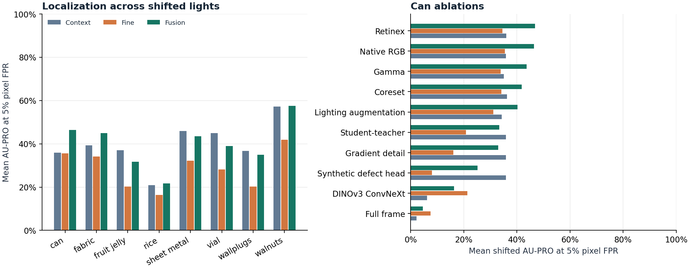

# Public-split experiment results

Each MVTec AD 2 public scene appears under several real lighting conditions. All methods evaluated here used the same captures and each capture's own mask. The main screen includes 1,084 captures of 184 scenes across all eight categories. The original MVTec AD Bottle category was used for a pipeline check. Its results do not enter the AD 2 comparisons. [MVTec AD 2 study and protocol](https://link.springer.com/article/10.1007/s11263-026-02743-0)

## Method

1. Fit each reference on 96 evenly spaced normal source images, per category, in sorted filename order. Native methods use 256 × 256 crops with at least 25% overlap. Full-frame methods fit the image inside 256 × 256 with reflected padding.
2. Score the detail branch at stride four and the context branch at stride eight. The context grid includes pooled stride-eight and stride-sixteen features. The main method uses a frozen ResNet-18. Its banks hold 1,024 detail and 4,096 context patches, so the fourfold denser grid has a quarter as many references to compare. Reconstruct each map in native coordinates using tapered overlap weights and a fixed two-pixel Gaussian smoothing radius.
3. Scale each branch by its median normal-validation image maximum and average the two maps with equal weight. Set a separate 90th-percentile normal-validation image threshold for each tested part score. Local contrast uses the same heatmap and a separate score from its sharpest responses. Bank fitting and threshold calibration use good source images. The public masks enter evaluation only.
4. Measure AU-PRO up to 5% pixel false-positive rate, separately by category and light. The local estimate uses 4,096 histogram bins. Tiny overlap is mean coverage at the operating point of 5% pixel FPR for connected mask regions occupying at most 0.01% of the source image. Tiny overlap is averaged only across lighting groups with qualifying regions. The part decision threshold is independent of this swept pixel operating point.

Reported shifted means weight lighting conditions equally within each category. Error counts pool captures. Scene bootstrap intervals preserve the repeated lighting views of each part and resample good and defective scenes separately. Timing starts after decoding and includes transforms, both maps and fusion. These measurements came from a laptop under variable load, with some ablations overlapping. They describe the experimental compute budget and do not include camera or production-station cycle time.

## Transfer across eight categories

| Category | Context AU-PRO | Fine AU-PRO | Fusion AU-PRO | Context → fusion tiny overlap | Context misses, false rejects | Fusion misses, false rejects |
| --- | ---: | ---: | ---: | ---: | ---: | ---: |
| Can | 35.9% | 35.5% | 46.4% | 50.5% → 73.1% | 70/75, 9/60 | 54/75, 15/60 |
| Fabric | 39.3% | 34.1% | 45.0% | 54.0% → 64.8% | 42/75, 13/55 | 37/75, 10/55 |
| Fruit jelly | 37.0% | 20.2% | 31.8% | 44.3% → 44.7% | 39/45, 1/15 | 40/45, 2/15 |
| Rice | 20.9% | 16.4% | 21.6% | 56.3% → 96.4% | 59/75, 1/35 | 62/75, 0/35 |
| Sheet metal | 45.9% | 32.2% | 43.5% | 44.6% → 42.2% | 41/75, 0/20 | 45/75, 3/20 |
| Vial | 45.0% | 28.1% | 38.9% | 94.6% → 96.7% | 80/90, 10/30 | 87/90, 5/30 |
| Wallplugs | 36.7% | 20.2% | 34.9% | 65.3% → 67.9% | 33/75, 23/50 | 75/75, 3/50 |
| Walnuts | 57.1% | 41.9% | 57.4% | 100.0% → 100.0% | 24/75, 6/50 | 48/75, 5/50 |
| **Category mean** | 39.7% | 28.6% | 39.9% | 63.7% → 73.2% | 388/585, 63/315 | 448/585, 43/315 |

Fusion led context and fine localization in four categories. It recovered much more of the tiny rice regions by the 5% false-positive operating point. Context had higher low-FPR integrated overlap on Fruit Jelly, Sheet Metal, Vial, and Wall Plugs. The small overall difference in AU-PRO conceals these material-dependent changes. Under the fixed part thresholds, context missed fewer shifted defective captures and fusion falsely rejected fewer good captures.

## Can method screen

| Same 96 normal source images | Context AU-PRO | Fine AU-PRO | Fusion AU-PRO | Fusion tiny overlap | Fusion misses, false rejects |
| --- | ---: | ---: | ---: | ---: | ---: |
| Full frame, ResNet | 2.6% | 9.5% | 5.8% | 3.7% | 66/75, 7/60 |
| Native RGB, ResNet | 35.9% | 35.5% | 46.4% | 73.1% | 54/75, 15/60 |
| Bounded gamma | 35.0% | 33.8% | 43.6% | 72.8% | 55/75, 20/60 |
| Mild Retinex | 36.0% | 34.5% | 46.9% | 74.2% | 66/75, 16/60 |
| Simulated lighting in training | 34.3% | 31.1% | 40.3% | 63.8% | 63/75, 10/60 |
| Projected farthest-first bank | 36.3% | 34.1% | 41.8% | 65.1% | 46/75, 25/60 |
| DINOv3 ConvNeXt-Tiny | 6.2% | 21.4% | 16.3% | 16.5% | 65/75, 5/60 |
| Sobel and Laplacian detail | 35.9% | 16.0% | 33.0% | 53.9% | 65/75, 13/60 |
| Synthetic-defect head | 35.9% | 7.9% | 25.2% | 39.4% | 41/75, 28/60 |
| Student–teacher detail | 35.9% | 20.8% | 33.3% | 61.1% | 62/75, 10/60 |

Native images retain the decisive signal. Can fusion gained about 41 points of shifted-light AU-PRO over its matched full-frame control. Mild Retinex produced a small map-level gain, with 12 more misses than raw RGB fusion at the source-calibrated part threshold. Gamma and simulated broad lighting reduced localization. The projected farthest-first sampler drew from four times the final bank budget and kept the same number of references at prediction. It missed eight fewer defective captures while adding ten false rejects relative to native fusion. We chose native RGB fusion for the private-split localization run because it improved tiny-region overlap across categories and avoids a Can-specific preprocessing setting.

The DINOv3 challenger used frozen ConvNeXt-Tiny stages 0, 1, and 2 with the same windows and bank budgets. The gradient challenger replaced only the fine branch with oriented Sobel and Laplacian responses. The two trained branches used 180 optimizer steps and up to 512 good source crops. One learned from simulated narrow scratches and spots. The student–teacher branch learned to predict frozen stride-four teacher features with normal-only exposure augmentation. All three latter challengers kept ResNet context unchanged. Their fine maps trailed the native ResNet fine branch on Can.

Using all 412 good Can training images with the same bank sizes gave 39.1% context, 34.7% fine, and 43.8% fusion shifted AU-PRO. Fusion missed 56 of 75 defective captures and falsely rejected 19 of 60 good ones. [Full source fit](can_full_fit.json)

The coreset transferred differently from Can. At the same normal-image and final bank budgets, it raised fusion AU-PRO from 45.0% to 52.4% on Fabric and from 34.9% to 39.6% on Wall Plugs. The fixed fusion thresholds still missed 48 of 75 shifted Fabric defect captures and all 75 on Wall Plugs, compared with 37 and 75 for the uniform banks. On Can, the coreset context score alone reduced misses from 70 to 51 of 75 and false rejects from 9 to 6 of 60. These results give the coreset a case for further category-level tests, with its map and part scores measured independently.

The two original PatchCore-style controls and the reduced upstream SuperADD runs are documented in the [previous part scoring](scoring_comparison.md) and [SuperADD report](superadd.md). The reduced comparators use different normal budgets and model settings. The selection in this report concerns the matched public experiment.

## Part decisions and adaptation

The Can core result shows the difference between seeing the flaw and acting on it. On the five shifted lights, native fusion reduced missed captures from 70 to 54 of 75. The paired scene bootstrap interval for the change was −42.7 to −1.3 percentage points. False rejects increased from 9 to 15 of 60, with an interval of −18.3 to +35.0 points. Fabric improved both counts in this replay. Wall plugs exposed the opposite failure at the fixed fusion threshold, which passed all 75 shifted defective captures while reducing the number of good ones rejected.

Reviewing all Can captures where the context and fine thresholds disagreed would refer 47 of 135 shifted captures. That would leave 43 automatically passed defective captures, versus 35.2 expected from random referral at the same workload. It would also reduce automatic false rejects from 15 to 3, versus 9.8 expected under random referral. Those deferred outcomes remain unresolved. This policy may catch unnecessary rejects, but it is weak protection against defect escapes in the observed Can sample.

The extra-view replay used existing paired captures. For Can, the OR policy with `shift_1` as the second view reduced regular-view fusion misses from 13 to 8 of 15, with 5 of 12 false rejects in both cases. It re-imaged 20 of 27 parts, increasing mean views from 1 to 1.74. This example needs a fixed, independently verified lighting change before a production claim. [Full paired replay](paired_robustness.json)

Across all 495 choices of four good Can support scenes, the median-offset and bounded affine policies failed to jointly improve average misses and false rejects over the fixed thresholds for any tested part score. The simple acquisition gate referred 80.4% of changed-light captures in the Can replay. The source-calibrated gate also produced regular-light referrals in four of eight categories. The [acquisition and adaptation report](acquisition_and_adaptation.md) contains the support protocol, source calibration and physical capture implications.

A second commissioning replay mapped shifted patch features toward matched regular features using per-channel moments from four good scenes selected with seed 42. The correction used half-strength shrinkage and clamped the spread ratio to 0.5–2.0 before shrinkage. The 115 held-out captures exclude all views of those four scenes. With the raw score threshold and fusion scales fixed, localization moved from 47.19% to 47.40% AU-PRO while part AUROC moved from 48.83% to 48.33%. Misses rose from 54 to 61 of 75 defective captures and false rejects fell from 10 to 8 of 40 good ones. Refitting reproduced the stored baseline scores exactly on the recorded GPU. [Per-light feature calibration results](feature_adaptation.json)

## Released comparison and station protocol

The released SuperADD Can configuration was run on the same 162 public captures. It reached 4.91% mean AU-PRO under the five changed lights, with 34 of 75 defective captures missed and 28 of 60 good captures rejected under its published mask rule. [SuperADD reproduction and per-light results](superadd.md)

The station workflow validates disjoint physical parts, matching lighting views, recorded exposure and gain, and native image and mask geometry. It also measures contrast and can score each lighting condition using the same frozen nominal-light threshold. The workflow passed synthetic input and inference checks. Station measurements require independent captures of verified parts. [Station protocol and commands](../STATION_PROTOCOL.md)

## Local archive

The 19.88 GiB native RGB fusion archive passed MVTec's local checker. It contains 2,045 continuous float16 TIFF maps and 2,045 binary PNG masks for each of the two private splits. The archive stays in the local `artifacts` directory. Its [file manifest and SHA-256](benchmark_export.json) record the configuration and exact artifact. The portfolio results use the public labels and the archive records local format validation. [MVTec benchmark format](https://benchmark.mvtec.com/submit)

[Per-light metrics and part decisions](multiscale.json) · [Paired decision and reinspection results](paired_robustness.json) · [Research and alternatives](../RESEARCH.md)
