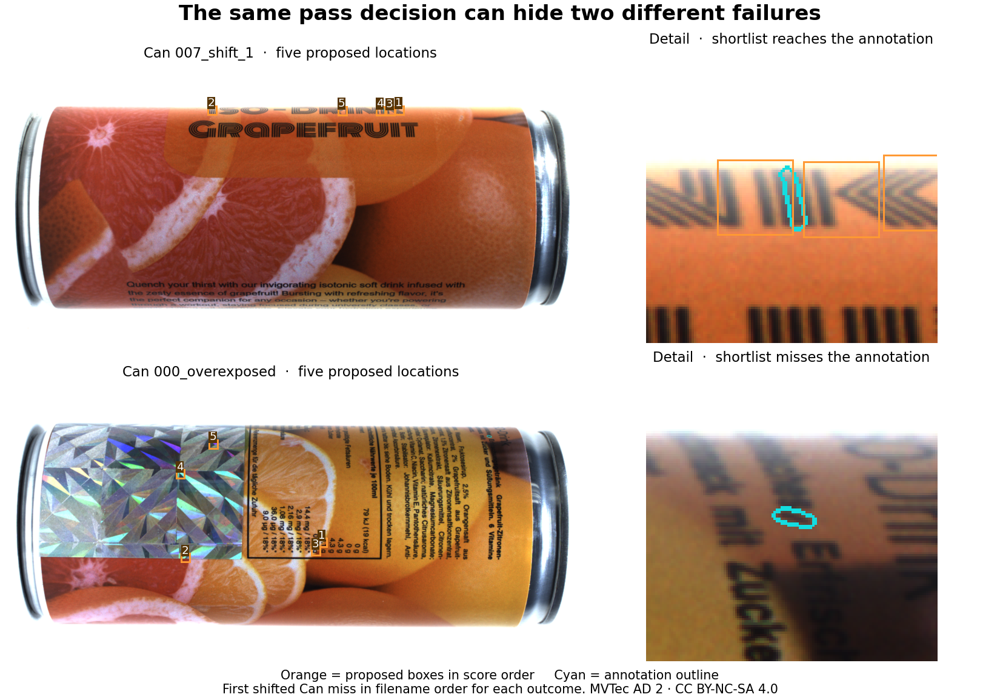
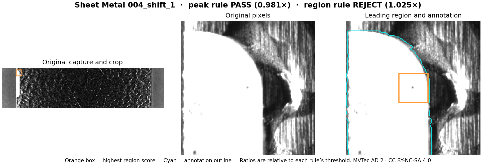
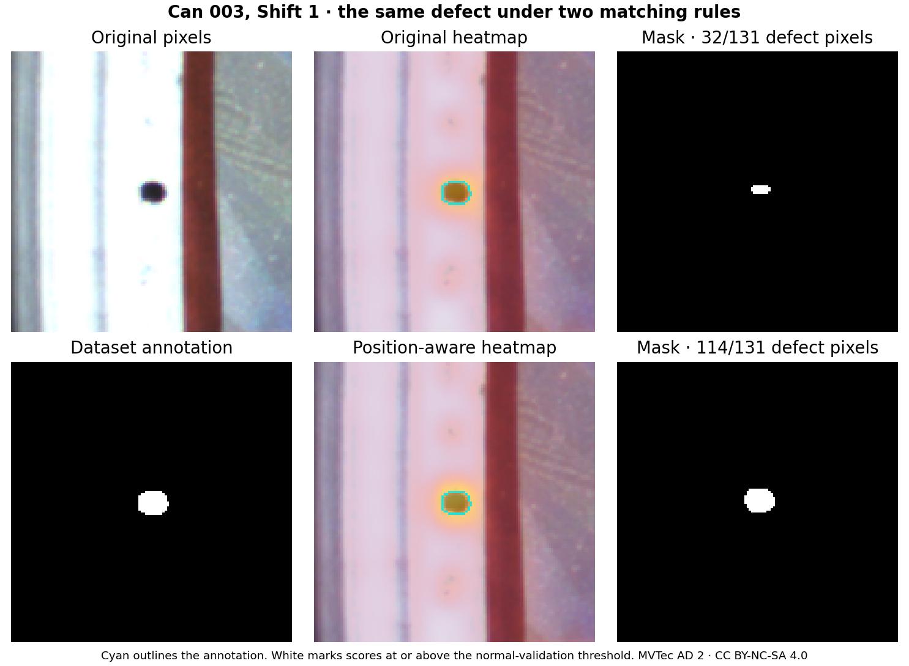

# Where does the detector look when it misses a part?

I started this follow-up with one question. When my detector passes a defective part, does it see the flaw and give it too little weight, or is it looking somewhere else entirely? The distinction matters. A better decision rule can rescue the first case. The second needs a better source of visual evidence.

**The clearest decision gain was on Sheet Metal.** A region-based score caught 20 additional shifted defective captures at the same observed false-reject count. **The clearest mask gain was on Can.** Position-aware matching raised pixel F1 from 2.89% to 8.02%, even as more defective parts passed inspection.



Each orange square covers up to 33 × 33 original pixels. Cyan outlines the dataset annotation. Both parts were passed by the original inspector. The top example has a proposed box touching the flaw, although the peak itself misses it. The lower example has five stronger responses elsewhere on the can. I selected the first shifted baseline miss in filename order for each outcome.

## How I tested it

I rebuilt the original two-branch detector from the same 96 good images per category, with its original patch-bank sizes and normal-validation scaling. In each heatmap I picked the strongest remaining pixel and proposed a box extending 16 pixels in every direction. I repeated this up to five times, excluding locations that would overlap a previous box. Boxes are clipped at the image edges. A hit means a box touches at least one labeled pixel. I also measured the stricter test of whether the peak pixel itself lies inside the annotation. A capture with multiple defects counts once if any one is found.

I then fitted a region scorer on **32 additional good training images per category**. These are separate from the 96 reference images and the good validation split. For each candidate I measured its peak, its excess above the median of the surrounding ring, and its mean positive excess across the box. I compared those three measurements and the candidate's coarse image position against normal hotspots. The three closest good examples provide the score, and the highest-scoring region provides the part decision. The original and new scores each use their own 90th-percentile threshold from the same regular-light good validation images.

The new part score uses the original heatmap, so its pixel localization metrics are the same by construction. Finding and scoring the five regions took a median 3.9 ms per shifted Can image, after about 208 ms for the heatmap. Across categories the median added cost ranged from 3.9 to 8.4 ms. I measured decision changes across **every public category**, keeping all lighting views of a physical scene together for uncertainty estimates. Box hits, center hits, and tiny-only subgroups use each capture's own annotation after inference. “Tiny-only” means every connected defect occupies at most 0.01% of that image.

On Can the five boxes covered a median **0.24% of the image**. They touched a defect in 7 of the 75 shifted defective captures. Five hits came from the five lighting views of scene `bad/003`. The other two came from scene `bad/007` under Shift 1 and Shift 3. Those last two were the only box hits among the original detector's 54 missed captures, and neither peak center landed on the flaw. Capturing a flaw in the top five on two views of one part is a narrower result than the capture count alone suggests.

## Where the region rule helped

On changed-light Sheet Metal, I caught **50 of 75 defective captures**, up from 30, with both rules falsely rejecting three of the 20 good captures. The new rule recovered 23 captures that previously passed and lost three that were previously caught. Its leading box touched a labeled defect in eight of those 23 newly caught captures. A correct reject can still point the operator to the wrong place.



I chose the first shifted Sheet Metal capture in filename order that changed from pass to reject and whose leading box reached the annotation. The outcome table includes every capture. A paired bootstrap of defective scenes gave a 95% interval of +7 to +34 for the change in caught captures. The corresponding interval for false rejects was −3 to +3. The public sample is small and I compared multiple categories.

## Transfer across all eight categories

| Category | Top-five hits among baseline misses | Defects caught, peak → region | Good parts rejected, peak → region | Region rejects with a box on the defect¹ |
| --- | ---: | ---: | ---: | ---: |
| Can | 2 / 54 | 21 → 20 / 75 | 15 → 7 / 60 | 7 / 20 |
| Fabric | 13 / 37 | 38 → 29 / 75 | 10 → 11 / 55 | 12 / 29 |
| Fruit Jelly | 15 / 40 | 5 → 7 / 45 | 2 → 1 / 15 | 4 / 7 |
| Rice | 8 / 62 | 13 → 15 / 75 | 0 → 5 / 35 | 2 / 15 |
| Sheet Metal | 26 / 45 | 30 → 50 / 75 | 3 → 3 / 20 | 24 / 50 |
| Vial | 32 / 87 | 3 → 6 / 90 | 5 → 11 / 30 | 0 / 6 |
| Wall Plugs | 4 / 75 | 0 → 8 / 75 | 3 → 3 / 50 | 0 / 8 |
| Walnuts | 37 / 48 | 27 → 16 / 75 | 5 → 6 / 50 | 16 / 16 |
| **All shifted captures** | **137 / 448** | **137 → 151 / 585** | **43 → 47 / 315** | **65 / 151** |

¹ Among defective captures rejected by the region rule, this counts those whose highest-novelty box overlaps any annotated defect. The peak rule's corresponding total is 61 / 137. Each lighting view counts as a capture.

Pooling shifted captures, the region rule caught 14 additional defective captures and falsely rejected four additional good captures compared with the original peak rule. Against the earlier local-contrast score on the same fused maps, the new rule improved both totals. Local contrast caught 115 at 60 false rejects, compared with 151 at 47 for normal-region scoring. On Sheet Metal specifically, local contrast caught 51 at seven false rejects, compared with 50 at three. [Earlier score controls](multiscale.json)

The earlier context-only detector caught 197 at a cost of 63 false rejects on the same captures. The preferred operating point depends on the cost of an escape and a false alarm. Results also varied by product. On Wall Plugs it caught eight previously missed captures, yet its leading box missed the annotation on all eight. On Walnuts it caught 11 fewer. On Can it caught one fewer defect and prevented eight false rejects. The paired Can scene-bootstrap intervals were −19 to +19 for the change in caught captures and −17 to +1 for the change in false rejects.

I also checked the ranking while holding the observed Can false-reject budget at 15. Sweeping the public scores gave a best attainable 31 detections for the region score and 23 for the original peak score at that budget. These are retrospective ROC points. The thresholds fitted on normal validation images actually caught 20 and 21, respectively. I recorded the equivalent budget comparison, per-light results, hit rates at one, three and five proposals, tiny-only splits, and paired uncertainty by category. Intervals use 5,000 scene resamples per class, with the thresholds held fixed. They describe test-scene variation at the fitted operating points. [Machine-readable results](hotspot_study.json)

To check whether the boxes contain evidence specific to the part, I borrowed all five boxes from a good part photographed under the same light and tested them against the defective part's mask. I averaged over every matching good part. Sheet Metal's own boxes reached the flaw on 53 of 75 captures, compared with an expected 6.75 if I borrowed boxes. Vial's own boxes reached 33 of 90, compared with 27.6 borrowed. The same headline hit count can carry very different information when defects and normal hotspots occupy recurring positions.

## Can controls

After the initial shortlist diagnostic, I tested these fixed alternatives on Can. Each uses the original source images. Thresholds are fitted on good validation images before measuring defect outcomes.

| Alternative | What changed |
| --- | --- |
| Two grid offsets | I scored the original and a copy translated by two pixels on each axis, aligned the maps in original coordinates, and compared their mean and maximum. Unobserved border pixels retain the original score. |
| Position-aware patch matching | I added normalized image coordinates to the original feature vectors in both reference banks. A distant patch can still match, but pays a distance penalty scaled by the original branch's normal-validation maximum statistic. This tests coarse position in camera coordinates, which makes the comparison sensitive to changes in product pose. |
| Lighting-aware context | I used a clean crop and a simulated exposure/illumination change from each of the 96 normal source images to estimate how much each context channel changes with light relative to its normal spatial variation. I downweighted unstable channels and rebuilt the bank. The detail branch retains the original features. |
| CAT spatial agreement | I used the five strongest regions from each full-image detector. Each box receives the geometric mean of the two models' peak scores inside that box. I compared this against combining the two image-wide peaks, each detector alone, and acting on any alarm from the two original decision rules. |

In the lighting control I kept the original fine/context scaling for comparability and normalized the context weights to unit root-mean-square magnitude. Offsets change feature-grid phase and tile-boundary context together. The CAT agreement rule can accept nearby peaks inside the same box. It does not establish that both models identify the same defect pixel.

## What changed on the Can images?

| Can map | AU-PRO at 5% | Tiny overlap | Pixel F1 | Caught / 75 | False rejects / 60 | Median map time |
| --- | ---: | ---: | ---: | ---: | ---: | ---: |
| Original native fusion | 46.39% | 73.14% | 2.89% | 21 | 15 | 198 ms |
| Offset mean | 46.47% | 72.03% | 2.18% | 16 | 10 | 412 ms |
| Offset maximum | 46.94% | 72.37% | 1.87% | 15 | 6 | 410 ms |
| Position-aware matching | 47.74% | 75.99% | 8.02% | 14 | 19 | 204 ms |
| Lighting-aware context | 47.29% | 73.94% | 3.23% | 21 | 16 | 198 ms |

Coarse position gave the largest localization gain in this screen. It raised fixed-threshold pixel F1 in each of the five shifted lighting conditions. It also caught seven fewer defective captures and rejected four more good ones at its own normal-validation threshold. Even with a retrospective budget of 15 false rejects it caught at most 12, versus 23 for the original peak score. This is a better heatmap for this public Can comparison and a weaker way to decide whether to reject the whole part.



I reused scene `bad/003` from the original project gallery, under Shift 1. Both maps are shown at their own normal-validation scale. The original mask covered 32 of the 131 annotated pixels on this defect. Position-aware matching covered 114. Pixel F1 in the table also penalizes predictions on normal pixels across the whole lighting group.

The cost of checking two sampling positions was about one additional full pass. The maximum cut false rejects from 15 to six and also cut detections from 21 to 15. Lighting-aware context retained 21 detections with one additional false reject and a small localization gain. Among the original 54 Can misses, position-aware and lighting-aware proposals each touched the annotation once. Neither offset rule reached it in its first five boxes. Changes to overall map quality can leave the most suspicious locations far from the flaw.

For scale, the previously reproduced CAT checkpoint scored 33.87% AU-PRO and 4.21% pixel F1 on these same shifted Can images. The full SuperADD release scored 4.91% and 0.00%. The release-specific mask rules differ. Private leaderboard scores refer to different images. [Matched public model runs](released_comparators.md)

## Did position-aware matching transfer to Fabric?

After seeing the Can mask result I ran the same two matching rules on Fabric, with its own 96 normal reference images and source-calibrated thresholds. I kept the coordinate penalty, sampling budget and feature-scaling procedure fixed. On changed-light Fabric, AU-PRO **fell from 45.00% to 37.20%**, tiny overlap fell from **64.81% to 54.46%**, and pixel F1 went from **0.18% to 0.10%**. Detections fell from 38 to 23 of 75, with false rejects falling from 10 to 4 of 55. The five strongest boxes also reached fewer defective captures, 26 versus 34. Geometry helped on the Can images and hurt on Fabric in this transfer check. [Fabric measurements by light](fabric_position_transfer.json)

## Did agreement with CAT help?

The five boxes from the spatial agreement rule reached a real defect on **19 of 75** shifted defective Can captures, up from seven for the original native shortlist. Among the 54 captures the native rule missed, coverage rose from **2 to 9**. I compared both models on every public Can capture. The table uses the five changed lights.

| Can decision rule | Defective captures caught / 75 | Good captures rejected / 60 | Best catches at a budget of 15 false rejects¹ |
| --- | ---: | ---: | ---: |
| Original native peak | 21 | 15 | 23 |
| CAT peak with normal-validation threshold | 51 | 38 | 22 |
| CAT published binary-mask rule | 48 | 32 | — |
| Either original alarm | 52 | 39 | — |
| Combine the two image-wide peaks | 44 | 32 | 21 |
| Combine peaks from the same box | 46 | 37 | 27 |

¹ I swept the continuous score on the public captures to describe its ranking. Fixed binary rules supply only one operating point. The source-calibrated decisions are the two middle columns.

Requiring nearby evidence improved ranking over combining independent peaks. At its actual normal-validation threshold, the spatial rule caught two fewer defective captures and falsely rejected five more good ones than CAT's published mask rule. It also took a median **2.15 seconds** per image including both detectors and proposal scoring. The region rule on our single detector reached 31 catches at the same retrospective budget of 15 false rejects. I retained the two-model run as evidence about where to look. I would use the cheaper region scorer first for decisions on this dataset.

## What I kept

The original native fusion rule remains the default. I added normal-region scoring as an optional part decision and position-aware matching as an optional map generator for inspection. For shifted Sheet Metal I would use the region score first. For a Can localization study I would include the position-aware map alongside the original. The Fabric results rule out using either change as an across-category upgrade on the strength of the Can or Sheet Metal results alone. All model choices here were explored on public images that I had already examined.

## Reproduce

From the repository root with MVTec AD 2 available locally, run the following with the project's Python environment. The figures use Matplotlib. I used CUDA throughout. For a CPU reproduction, pass `--device cpu` to each model runner and the map figure command so the regenerated random banks agree with the recorded control.

```powershell
python hotspot_study.py can fabric fruit_jelly rice sheet_metal vial wallplugs walnuts
python report_hotspots.py
python sampling_study.py can
python sampling_study.py fabric --position-only
python plot_hotspots.py --position-example
python cat_hotspot_study.py
```

To inspect individual images with the experimental region decision and view its proposals in decision-score order, I use the local inspector. It fits using good training and validation images, reads each input, and can save an annotated image and a JSON decision. The position-aware map is also available in the regular scoring command.

```powershell
python inspection.py regions can mvtec_ad_2_dataset/can/test_public/bad/007_shift_1.png --output artifacts/region_demo
python inspection.py score can mvtec_ad_2_dataset/can/test_public/bad/003_shift_1.png --method position --output artifacts/position_demo
```

The CAT experiment requires the release and checkpoint documented in the [matched comparison](released_comparators.md). The native experiments use the existing ResNet weights. The scripts store per-capture coordinates, scores, evaluation flags, validation records, and normal-source paths under `artifacts/hotspots`. The summaries are [all-category decisions](hotspot_study.json), [Can localization controls](can_sampling.json), and [Can model agreement](can_cat_agreement.json).

MVTec images and annotations are used under CC BY-NC-SA 4.0. The proposal outlines and scores are outputs from the local experiments. [MVTec AD 2](https://www.mvtec.com/research-teaching/datasets/mvtec-ad-2)
