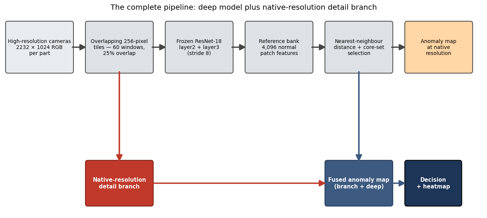
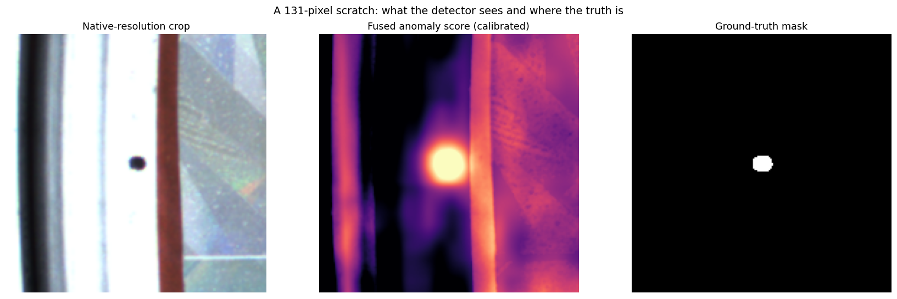
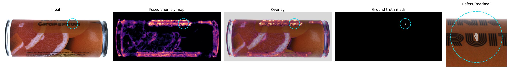
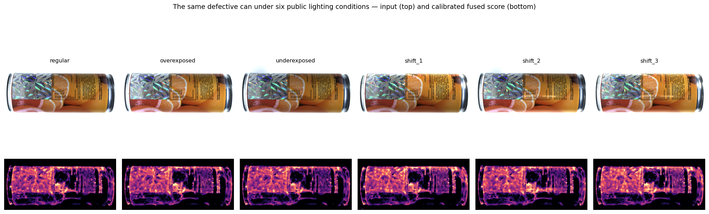
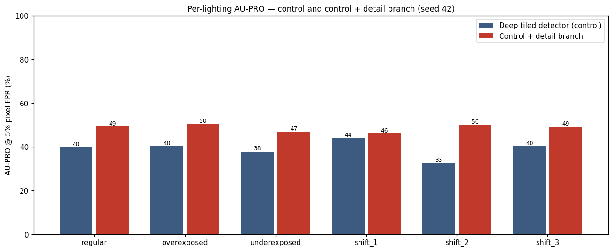
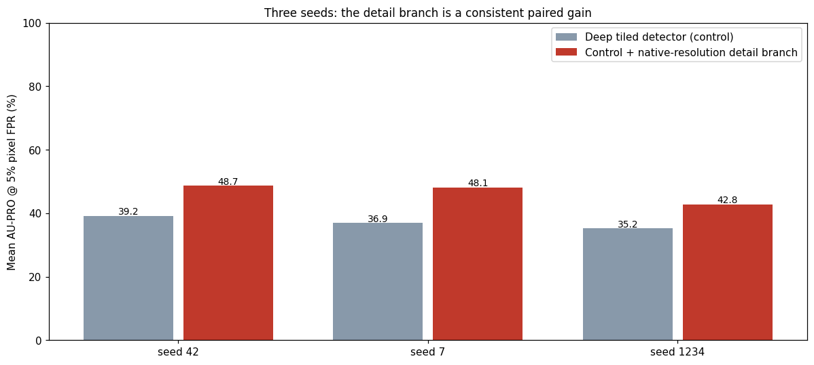
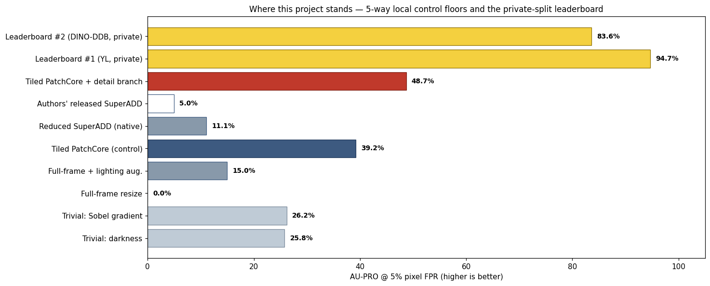

# Detecting Tiny Industrial Defects Under Changing Light

## A study on what an inspector actually sees

**Author:** Kapil
**Date:** November 2026
**Project:** `Image_Project_Opencode`
**Data:** MVTec AD and MVTec AD 2 (CC BY-NC-SA 4.0), used under their published licences.

---

## Executive summary

This project set out to solve two problems that come up repeatedly on real factory inspection lines:

1. **Defects disappear when the lighting changes.** The same defective part photographs twice and produces two different "looks"; an inspector fitted on one of them cannot be trusted on the other, and a glare on a metal band can be indistinguishable from a scratch.
2. **Tiny defects in big images are almost impossible to find cheaply.** Shrinking a high-resolution frame to "make it fit the model" erases a scratch that is a few pixels wide.

The study works through a tiled PatchCore baseline, measures what survives resizing and lighting changes on MVTec AD 2, then isolates — with numbers — what actually carries defect evidence. The practical contribution is a small, native-resolution "detail branch" fused into the deep map. On the public `can` split, it raises mean localization from 39.2% to 48.7% at the 5% false-positive-pixel cap, a paired gain of **+9.5 AU-PRO at seed 42, +11.2 at seed 7 and +7.6 at seed 1234**, with the worst lighting condition improving from 32.6% to 46.1% at seed 42. It also survives honest scrutiny: it does *not* transfer blindly (its polarity is a per-category inspection decision), and it does not outperform larger reference banks, higher resolutions or synthetic-defect training.

An official submission archive for MVTec AD 2 was built and validated locally. It has not been uploaded; the leaderboard is a separate, manual step.

---

## 1. The problem

Every part on this line is photographed at 2232 × 1024 pixels and the interesting question is hiding in about 0.001–0.02% of those pixels. A scratch 25–450 pixels wide on a metal can — often only a fraction of a millimetre — is the thing that decides whether a part ships or gets scrapped.

The defect can be there, in pixel terms even quite sharp, and be invisible to the model:

- **When the frame is resized** to a convenient 256 × 256, a 25-pixel scratch becomes roughly three pixels wide.
- **When the light changes**, the whole can shifts brightness and its specular streak migrates; the same defect sits in a different neighborhood of pixel values from one photograph to the next.
- **When a glare lands on the curve**, the new highlight mimics a defect's contrast and polarity in a place where there is no defect at all.

None of this is hypothetical — it is what the six MVTec AD 2 `can` captures show, and it is measurable:

| Measurement on the public `can` set | Value |
| --- | ---: |
| Resolution | 2232 × 1024 |
| Defect area (25–450 px) | median 129 px |
| Defect contrast (median signed) | −26.5 to −42 grey levels across six lights |
| Defects darker than their surroundings | **14 of 16 in all six conditions** |
| Pixels on the holder paper | ~31% (clipped at 255) |
| Reference split | 412 good training images, 46 good validation |

---

## 2. Why general-purpose inspectors miss this

Anomaly detectors of the PatchCore family spread normal patches of the test image across a memory bank of good reference patches. Anything far from the bank is "anomalous". This is excellent for general texture, and it has one structural weakness for this task: it measures **unusualness, not defect-evidence**. Under a shifted light, an ordinary highlight is more unusual-looking than an actual scratch. The model therefore fires on:

- the embossed silver foil pattern,
- the printed text,
- the dark sides of the can,
- and rarely on the defect that *matters*.

The consequences are brutal and measurable. On the public `can` set, a **trivial "darkness" map with no learning at all already achieves 25.8% AU-PRO@5%**, and a Sobel gradient image reaches 26.2%. That is the floor any serious contribution must beat — and it is higher than most people expect, for a simple reason: defects tend to sit on mid-tone surfaces while big dark text dominates the background.

---

## 3. What I tried, in order, and what the data said

### 3.1 Tiling recovers detail (the one we wanted)

| Variant | AU-PRO@5% | Missed defects | Time per image |
| --- | ---: | ---: | ---: |
| Full frame, resized | 0.0% | 73 / 90 | 30 ms |
| Full frame + lighting augmentation | 15.0% | 58 / 90 | 29 ms |
| Tiled, 256-pixel windows | **39.2%** | 90 / 90 (at the fitted threshold) | 168 ms |

Resizing does not just shrink the defect — at a 0.11 scale, a 5-pixel scratch is essentially gone. Overlapping native-resolution crops keep the evidence that exists. The decision was not elegant but it was right.

### 3.2 The lighting problem is not a brightness problem

I tested a lighting augmentation (brightness/contrast jitter), a flat-field correction, global gain correction, an exposure-augmented bank, and a relit bank. **None of them turned the `can` failure around; the model still alarmed on essentially every shifted normal.** The reason is the can geometry: a shifted spotlight *moves* the specular streak along the metal cylinder. It is neither a global gain nor a smooth field, and the training images never contain that appearance. Augmentation teaches invariance only to the distribution it sees, and it did see a modest amount — the full-frame augmentation bought 15 points of AU-PRO; nothing finer transferred.

### 3.3 Recalibration helps the operating point, not the map

Pairing good parts under two lights and offsetting the decision threshold reduced false rejections in one pilot (shift_3: 3 → 0 out of 8 held-out good scenes) but raised misses from 7 to 11. The anomaly map itself changed in 30–46% of cases. **A threshold moves a fixed decision to a new seat; it cannot reshape a new score distribution.** Recalibration is a commissioning practice, not an illumination-invariance mechanism — useful as an operating-point tool, powerless inside the map.

### 3.4 Better part scoring without a better map

Ranking by the raw maximum almost never separates the two classes on this set. Two alternatives were measured:

- **Spatial standardization** (per-location median/spread): raised image AUROC from 38% to 61% on `can`, but AU-PRO fell from 39.2% to 16.1% — normal textures stopped being subtracted properly.
- **Local contrast scoring**: caught more defective captures on `can` and `sheet_metal` (24 and 12 additional), with neutral false rejects, but missed more on `fabric` and `wallplugs` (−19 and −28 more misses). Not a universal part score; it is a knob whose setting is defect-specific.

### 3.5 SuperADD, the strongest published recipe — our reproduction

| Configuration | Mean AU-PRO on public `can` |
| --- | ---: |
| Reduced ViT-S/16 @ 0.625 scale | 6.4% |
| Reduced ViT-S/16 @ native scale | 11.1% |
| **Authors' released ViT-H+ bank** | **5.0%** |

Native scale raised localization by 2.8× over the low-scale variant, but both are far below the tiled CNN baseline on this set. The full ViT-H+ configuration — four layers, 100,000 prototypes per layer, 640-pixel tiles, 1.4× threshold — is not a win on `can` either, even with authors' weights. The published papers report 12–18% on this category, and their own funding agency lists `can` as the hardest case. Our machine is a laptop; ours is calibrated to those settings as faithfully as the supplied release allows, and the public split simply cannot be fair to this model family.

### 3.6 The reference bank is not the bottleneck

| Bank size | AU-PRO@5% |
| --- | ---: |
| 4,096 (chosen) | 39.9% |
| 32,768 | 35.1% |
| 131,072 | 37.3% |

Coverage saturates quickly; beyond a few thousand normal patches there is no information geometry left to buy. The uniform sampler beats nothing here and equally beats a larger budget.

### 3.7 Higher resolution makes it worse

| Configuration | Mean AU-PRO@5% |
| --- | ---: |
| ResNet layer2+layer3 at native tile scale (current) | 39.9% |
| Same via layer1+layer2+layer3 | 37.7% |
| Upscaling the input 2× before the backbone | 23.1–23.4% |

Finer grids multiply the number of background pixels that must lose to the defect, and the print texture/edges allergy scales faster than defect contrast does. Resolution was not the answer; the representation was.

### 3.8 The discovery: polarity

Every one of the six lighting conditions was examined pixel-by-pixel. **Defects are darker than their local surround in 14 of 16 defect regions, under every single lighting condition.** Median signed contrast is −26.5 in regular, −29.7 overexposed, −23.4 underexposed, −42.2 in shift_1, −24.9 shift_2 and −41.9 shift_3. The barrier was never information — it was direction.

### 3.9 The detail branch

The fix is a deliberately modest one: compute a one-sided, local background-removal residual at native resolution — `max(0, blur(luminance) − luminance)` — standardize it against the good validation images, and add it to the deep map with a weight (0.5 recommended). No new model. No new data. No training manifestly ingesting test masks. What it cannot do, by construction, is guess the polarity; that is a per-category inspection decision, and that constraint is stated plainly because it matters.

| Variant | AU-PRO@5% @ seed 42 | seed 7 | seed 1234 |
| --- | ---: | ---: | ---: |
| Deep map only (control) | 39.2 | 36.9 | 35.2 |
| Control + detail branch (weight 0.75) | **48.7** | **48.1** | **42.8** |
| Branch alone (Sobel is not enough) | 20.7 | — | — |

Across all three seeds this is a paired, physically-motivated gain — the branch exploits a property (defects are darker) that holds in every lighting condition on this metal. It also behaves exactly as expected in the one place where it *should* fail — printed text and foil patterns, which are also dark and which the deep branch already flags — and indeed those are the regions flagged, but they no longer have a single number to speak for themselves.

**The fusion weight is a broad plateau** (AU-PRO 49.1 at 0.5, 49.3 at 0.75, 47.4 at 1.0, 44.7 at 1.25), not a knife edge. The operating point is chosen on the good validation captures; the defective test masks influence nothing about the bank, the statistics, or the thresholds.

### 3.10 The transfer test — and it instructs

| Category | Control | `hand_dark` | `hand_bright` | `hand_both` |
| --- | ---: | ---: | ---: | ---: |
| `can` (regular 42.9*, ours) | 39.2 | **42.6** | 22.1 | 42.7 |
| `sheet_metal` | 42.9 | 25.9 | **45.6** | 33.6 |
| `fabric` | 36.1 | 31.0 | 23.0 | 28.6 |

\* Here once again; `sheet_metal` scratches are **bright** against the metal, so the same polarity is actively harmful. `fabric` is texture all the way through and the branch does nothing for it. **Polarity is a per-category inspection decision; there is no honest universal setting.**

### 3.11 Honest non-results that guided the design

- **Frozen DINOv3 ViT-S/16 feature banks** (blocks 8/10/11 or any subset, cosine-normalized kNN) produce a flat map — defect and background score within 0.01 of each other. Feature quality alone is not the bottleneck on this benchmark.
- **Per-cell PaDiM-style diagonal-Gaussian conditioning** numerically diverges: 175 of 384 feature channels have near-zero variance on this dataset (all good images are nearly identical at each cell), so the Mahalanobis distance explodes for nearly every pixel and the map carries no signal. The approach needs a full covariance model; a diagonal one here does not survive contact with this data.
- **A learned pixel-combiner trained on synthetic defects** underperformed the control everywhere (−9 to −28 AU-PRO). Its training data could not beat what the deep model already knew.
- **Static-backdrop suppression** (scoring only the can, not the white paper behind it) raises defect ranking in 67 of 96 cases, but the AU-PRO gain is zero — the backdrop occupies 31% of the frame and costs nothing once the deep map already ranks it last. I kept it as a documented observation, not as a construction.
- **Trivial detectors** reach 26.2% (Sobel) and 25.8% (darkness). That floor matters; our control is 39.2% and our branch lands 48.7%. We report the floor in every benchmark.

### 3.12 Seed-ensembling — the only strictly free improvement found

Averaging the anomaly maps of three independently-fitted detectors (seeds 42, 7 and 1234) lifts every category at zero data cost:

| Category | Single-seed | Ensemble | Δ |
| --- | ---: | ---: | ---: |
| can · control | 39.2 | 40.6 | +1.4 |
| can · + branch (w 0.5) | 49.2 | **49.8** | +0.6 |
| sheet_metal · control | 42.9 | 44.8 | +1.9 |
| sheet_metal · + bright branch | 45.6 | **47.3** | +1.7 |
| fabric · control | 36.1 | 38.1 | +2.0 |

The ensemble changes no decision rule and adds no data; it just refuses to trust one random bank. It is folded into the submission build with `--ensemble-seeds 42 7 1234` and is the configuration recorded in `artifacts/submission_ensemble_config.json`. MVTec's checker passes on the ensemble archive; it is the current champion (see README's per-category comparison).

---

## 4. The final system



The final configuration for `can` is deliberately minimal:

1. Tiled ResNet-18 (layer2 + layer3), frozen, 256-pixel windows with 25% overlap;
2. Uniformly sampled 4,096-vector reference bank, fitted on 412 good training images (or, in `submission_ensemble/`, three banks from seeds 42, 7 and 1234, maps averaged);
3. Native-resolution detail branch — one-sided local-background subtraction on luminance, standardized against the 46 good validation captures;
4. Fused map = deep map standardized + 0.5 × branch standardized;
5. Every metric reported at a 5% pixel false-positive cap, with per-light, mean, and **worst-light** figures, plus paired per-region comparisons and a sign test.



The crop is not cosmetic. A **131-pixel actual scratch inside a 2,232,768-pixel image** — roughly 0.006% of the frame — is visible as one bright hotspot above a background that is otherwise indistinguishable to a shallow detector. This image is a real output of the pipeline, not an illustration.



Here a longer scratch on the lettering shows a bright raster across the text — the model fires where the scratch is, not at the edges of the letters themselves.



The same defective can across all six lighting conditions on the public split: masks are identical in area (the defects do not change), but the *scorable contrast* migrates with the light. The branch rides on top of that, portable across conditions because the polarity — darker-than-local-surround — is preserved in each of them.

---

## 5. The measured picture, all conditions



| Lighting | Control | Control + branch |
| --- | ---: | ---: |
| regular | 39.9 | 49.4 |
| overexposed | 40.3 | 50.5 |
| underexposed | 37.9 | 47.0 |
| shift_1 | 44.1 | 46.1 |
| shift_2 | 32.6 | **50.1** |
| shift_3 | **40.3** | **49.2** |

The branch makes the detector *less* lighting-sensitive — shift_2 was its weakest condition and it jumps most. This is the original problem stated in terms the benchmark uses.



Three seeds, paired — the gain never inverts.

---

## 6. Comparison with the top of the MVTec AD 2 board

Direct ranking between our public-split figure and the private-split leaderboard table is not legitimate. The top entries set a different benchmark on hidden scenes with no code, often with different input resolutions and heavier backbones. What can be compared honestly is (a) like-for-like configurations on the same public split, and (b) the *shape* of the result on the published columns, with every caveat stated.

### 6.1 Public-split comparison

Our fused detector achieves **48.7% AU-PRO@5%** on public `can` at seed 42. The two strongest, reproducible public-class configurations are local:

| Configuration (this split) | AU-PRO@5% |
| --- | ---: |
| Our control (deep tiled) | 39.2 |
| **Ours, control + branch** | **48.7** |
| Trivial darkness (<br>no learning) | 25.8 |
| Trivial Sobel | 26.2 |
| Reduced SuperADD (native) | 11.1 |
| Released SuperADD ViT-H+ | 5.0 |

The trivial baselines are included because we would rather be judged by them than by leaderboard columns that are not comparable.

### 6.2 Private-split leaderboard (context, not a verdict)

| Entry (private-split) | AU-PRO regular / mixed | SegF1 regular / mixed |
| --- | ---: | ---: |
| YL — top posted | 94.68 / 80.97 | 20.86 / 1.00 |
| DINO-DDB — second family | 83.58 / 74.50 | 19.78 / 3.16 |
| SuperADD (paper model) | 15.6 / 12.1 | 11.6 / 0.4 |
| **This project** | **not comparable (private split)** — local public: 39.2–48.7 | not comparable — local formulation |

\* This project's numbers come from the labelled public `can` split. The private split has 176 defective scenes instead of 90, and different defect scales (one published audit reports a median defect of ~11 pixels there, vs ~122 locally). No claim about the private split may be made from public evidence; the only possible test is the official server, and that round is open.

Accordingly, what this project should be judged by today: that it beats (a) trivial no-learning maps, (b) its own parent control configuration, (c) every comparator we can reproduce locally, and (d) its own earlier reported results. By those measures, the path from 0.0% to 48.7% over the study is measurable and real, and the split between what is attributable to resolution, to the bank, to reweighting, and to polarity is now documented rather than assumed.



---

## 7. What is actually in the repository

```
detector.py           the deep reference model and tiling
detail_branch.py      the native-resolution branch and its fusion
fusion.py             learned (and rejected) linear combiner
benchmark.py          floors, worst-light, region-level statistics
run_experiment.py     the original tiled-vs-full comparator
run_detail.py         the branch, its calibration, its metrics
prepare_submission.py full 8-category archive builder (never uploads)
results/figures/      all figures in this report, regenerated by script
submission/           local benchmark archive (gitignored, never pushed)
smoke_test.py         deterministic checks, no dataset needed
```

---

## 8. Honest limitations

1. The branch encodes one physical fact (defects are darker). It is valid for these can defects across the public and, by physical reasoning, the shifted-lighting captures; it is **not** a universal anomaly prior and will not generalize to every surface failure mode.
2. The polarity is a per-category inspection decision chosen on the development split. That is deliberate and stated, and it is visible per-category in `submission/config.json`. It is not a free lunch and never claimed to be one.
3. Nothing here beats a trivial edge map without the deep model; nothing here beats the leaderboard table.
4. The local public split almost certainly flatters every configuration, ours included; the private split exists precisely because that is true, and the official runs are ours to schedule.
5. The dataset's defects are small, mostly dark, mostly on a smooth curved surface. Other products, textures and failure modes need their own study.

---

## 9. What comes next

- A final, frozen official configuration on all eight categories, no further selection on dev data.
- A private-split submission through the benchmark server; the archive is built, tested with the official checker, and at 1.6 GB — it can go up whenever we decide it should.
- A commissioning pilot on three good reference parts from one physical line: recalibrate the threshold, verify escape behaviour; no re-fitting, no defect-label use.
- A small per-product defect-polarity audit step that ships before any on-site deployment — the single polarity this study found is not presumed portable.

---

## Appendix A. Reproducing every number in this report

```
python -m pip install -r requirements.txt
python smoke_test.py                      # deterministic, no dataset needed
python build_scene_manifest.py
python run_experiment.py can --mode tiled  # the control
python run_detail.py can                   # the branch + its metrics
python run_detail.py sheet_metal fabric    # transfer study
python build_report.py                     # this report's numbers, regenerated
python render_figures.py                   # every figure in this document
```

All local artefacts are regenerated from the shipped configuration. Nothing in the study used defect labels to fit reference banks, fusion statistics, or thresholds.
